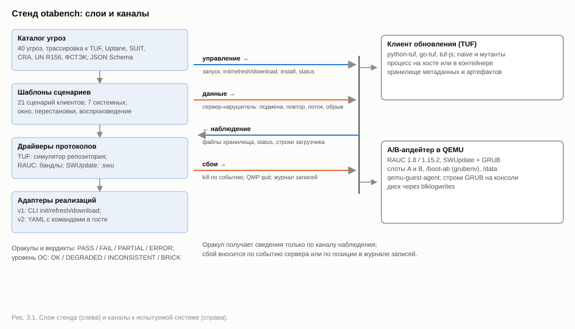

# Глава 3. Архитектура и реализация стенда otabench

В главе 2 описан метод: модель нарушителя, каталог угроз, оракулы по внешним наблюдаемым, модели сбоя питания и метрики. В этой главе описана его реализация в стенде otabench: компоненты и их взаимодействие, подключение испытуемых систем, построение состояний после сбоя и воспроизводимость. Метод не повторяется, на него даются ссылки. Результаты экспериментов приведены в главе 4, здесь они служат только свидетельствами того, что проектное решение было необходимо.

Стенд существует в виде прототипа из двух контуров. **Клиентский контур** — пакет `otabench` (около 1,8 тыс. строк на Python). Он испытывает клиентов TUF сетевыми атаками и обрывом процесса и строит матрицу «угроза × реализация». **Системный контур** — сценарии уровня ОС (`scripts/pilot_ab.py` и вспомогательные инструменты, около 1,1 тыс. строк) поверх общих модулей `otabench/vm.py` и `otabench/writelog.py`. Он испытывает A/B-апдейтер RAUC с загрузчиком GRUB в виртуальной машине на уровнях системы и блочных записей. Все прогоны выполнены на одном хосте под Windows 11. Что в реализации специфично для Windows, перечислено в п. 3.8.5.

Проектные решения, от которых зависит достоверность вердиктов, пронумерованы (Р1, Р2, …). Для каждого указаны проблема, альтернативы, выбор и свидетельство. Сводка приведена в табл. 3.19.

## 3.1 Общая архитектура

### 3.1.1 Компоненты

Стенд построен из шести ролей: оркестратор, адаптеры, сервер-нарушитель, инжекторы сбоев, оракулы и отчёт. Системному контуру нужны также управление виртуальной машиной и образ испытуемой системы (табл. 3.1).

*Таблица 3.1 — Компоненты стенда*

| Компонент | Файлы | Ответственность |
|---|---|---|
| Оркестратор клиентского контура | `otabench/__main__.py`, `otabench/runner.py` | команды `list`, `coverage`, `run`, `report`; параллельный прогон пар «сценарий, клиент»; `results.json` |
| Оркестратор системного контура | `scripts/pilot_ab.py` (класс `Pilot`) | сценарии A/B, построение и проверка состояний после сбоя, варианты конфигурации, `pilot.json` |
| Сценарии и оракулы | `otabench/scenarios.py`; метод `Pilot._check_point` | реестр сценариев с привязкой к угрозам, предусловия, вердикт `Outcome` (табл. 2.6); классификация состояния (табл. 2.7) |
| Адаптеры | `otabench/adapter.py`, `clients.yaml`, `clients/` | протокол tuf-conformance, управление процессом, чтение наблюдаемых |
| Адаптер устройства (протокол v2) | `otabench/device.py`, `updaters/rauc-grub.yaml` | команды апдейтера в госте: установка, состояние, перезагрузка, снятие подтверждения; разбор строк загрузчика; варианты конфигурации |
| Сервер-нарушитель | `otabench/server.py` | сцены с симулятором репозитория, правила атак, журнал запросов |
| Инжекторы сбоев | `_Killer`, `_kill_at` (`scenarios.py`), сопоставитель `nth_request` и правило `truncate` (`server.py`), `VM.power_cut` (`vm.py`), `WriteLog` (`writelog.py`) | обрыв процесса, соединения, питания ВМ; состояния диска после сбоя |
| Управление ВМ | `otabench/vm.py` | запуск QEMU; каналы QMP, последовательного порта и гостевого агента; журнал `blklogwrites`; эмуляция перезагрузки |
| Образ и гостевые файлы | `scripts/build_ab_image.py`, `vm/guest/*` | сборка образа A/B, бандлы, обработчик окружения загрузчика |
| Отчёт | `otabench/report.py` | `matrix.md`, `matrix.html`, `matrix.csv`; доли по общему набору, дифференциальные находки, мутационный анализ, покрытие каталога |
| Вспомогательные инструменты | `scripts/replay_state.py`, `vm_probe.py`, `qmp_powercut.py`, `setup.ps1`, `Dockerfile` | разбор одного состояния, проверка хоста, ручной обрыв питания, установка |

### 3.1.2 Каналы взаимодействия

Компоненты связаны каналами четырёх видов: управление, данные, наблюдение и сбои (рис. 3.1, табл. 3.2). Такое разделение следует из принципа внешних наблюдаемых (п. 2.3.1): оракул получает сведения только по каналу наблюдения. Код возврата приходит по каналу управления и потому вердикт сам по себе не определяет.



*Рисунок 3.1 — Компоненты и каналы стенда: слои (каталог угроз → шаблоны сценариев → драйверы протоколов → адаптеры реализаций) и четыре канала к испытуемой системе — управление, данные, наблюдение, сбои*

*Таблица 3.2 — Каналы взаимодействия*

| Канал | Клиентский контур (клиенты TUF) | Системный контур (A/B-апдейтер) |
|---|---|---|
| Управление | аргументы командной строки протокола tuf-conformance, запуск через `subprocess.Popen` | команды в госте через qemu-guest-agent (`guest-exec`); при сборке образа — оболочка через последовательный порт |
| Данные | HTTP от сервера-нарушителя: `http://127.0.0.1:<порт>/<сцена>/metadata/` и `/targets/` | бандлы RAUC в `/data/bundles`; файлы гостя раздаются по HTTP только при сборке |
| Наблюдение | каталоги клиента `metadata/` и `targets/`; итог процесса (код, длительность, обрыв, таймаут); журнал запросов сервера | последовательный порт (строка `otabench-grub`); через агента — `/proc/cmdline`, файл версии, `grub-editenv list`, `rauc status`; ответ агента как признак готовности |
| Сбои | `kill_switch` (TerminateProcess или SIGKILL); правила `truncate`, `endless`, `slow`; обратные вызовы `on_start`, `on_sent` | команда QMP `quit`; журнал `blklogwrites`, из которого строятся состояния диска |

**Р1. TCP на петлевом интерфейсе и гостевой агент вместо сети в госте.** *Проблема:* стенд должен работать на Windows и Linux, управлять гостем через перезагрузки и обрывы питания и не открывать каналов, которых нет в сценарии. *Альтернативы:* SSH по пользовательской сети QEMU; сокеты Unix. *Выбор:* QMP, последовательный порт и гостевой агент подключаются как TCP-серверы на 127.0.0.1 со свободными портами. Гость работает без сети (`-nic none`): агенту она не нужна, он работает через virtio-serial. Сеть включается только при сборке образа и вариантов, когда нужен `apt-get`. *Свидетельство:* один код `vm.py` работает на хосте Windows; `qmp_powercut.py` принимает и `tcp:`, и `unix:` адреса.

### 3.1.3 Жизненный цикл ячейки и сценария ОС

Ячейка клиентского контура — пара «сценарий, клиент». Функция `run_one` создаёт контекст `Ctx` и вызывает функцию сценария из реестра `REGISTRY`. Каждый вызов `Ctx.fresh()` даёт новую сцену на сервере и новое рабочее пространство клиента, инициализированное начальным root. Сценарий проводит атаку или сбой, читает наблюдаемые и возвращает `Outcome`: вердикт, пояснение, метрики. Пары выполняются пулом потоков (`--jobs`, по умолчанию 4) на одном сервере-нарушителе.

Сценарий системного контура — метод класса `Pilot`. Он создаёт оверлей qcow2 поверх базового образа, запускает ВМ, ждёт готовности и подтверждения слота, выполняет установку и затем перезагрузку, обрыв питания или запись журнала с перебором состояний. Результат — словарь с вердиктом и сырыми наблюдениями в `pilot.json`.

**Р2. Два оркестратора с общими модулями.** *Проблема:* ячейка клиентского контура длится от долей секунды до двух минут и почти не потребляет ресурсов, поэтому ячейки идут параллельно. Сценарий ОС длится от минуты до десятков минут, занимает оверлеи по 1–2 ГБ и сырой диск на 12 ГБ и идёт последовательно. *Альтернатива:* общий оркестратор с абстракцией «испытуемая система». *Выбор для прототипа:* отдельный оркестратор, общие модули `vm.py` и `writelog.py` и общий словарь вердиктов. *Цена:* результаты пилота не попадают в общую матрицу. Объединение запланировано вместе с выделением адаптера уровня ОС (п. 3.2.2).

## 3.2 Протокол адаптеров

### 3.2.1 Базовый протокол: CLI tuf-conformance

Базовый протокол взят у tuf-conformance без изменений [14] (табл. 3.3). Код возврата 0 означает успех, 1 — ошибку. Клиент с точкой входа для tuf-conformance подключается одной записью в `clients.yaml`. Так подключены python-tuf [185] (файл `python_tuf.py` копируется из tuf-conformance) и go-tuf [186] (собирается из каталога `clients/go-tuf` набора). Для tuf-js [187] написан собственный адаптер `clients/tuf-js/client.js` (66 строк).

*Таблица 3.3 — Команды базового протокола и таймауты стенда*

| Команда | Аргументы | Что делает клиент | Таймаут стенда |
|---|---|---|---|
| `init <файл root>` | `--metadata-dir D` | сохраняет начальный доверенный root | 30 с |
| `refresh` | `--metadata-url U`, `--metadata-dir D` | обновляет метаданные верхнего уровня | 30 с; при бесконечных данных — лимит сервера + 20 с, при медленной отдаче — лимит + 15 с |
| `download` | те же и `--target-name N` (повторяемый), `--target-base-url T`, `--target-dir TD` | обновляет метаданные и загружает цели | как у `refresh` |

Протокол реализует класс `ClientRunner`. Для каждого клиента он создаёт временное рабочее пространство с каталогами `metadata/` и `targets/`, которое удаляется после сценария. Так выполняется обязательство независимости прогонов (п. 2.7.3). Цикл ожидания процесса каждые 2 мс проверяет «рубильник» `kill_switch` и таймаут и при срабатывании вызывает `proc.kill()`: на Windows это TerminateProcess, на POSIX — SIGKILL. Результат `RunResult` содержит код возврата, длительность по монотонным часам, признаки `killed` и `timed_out` и две последние содержательные строки вывода. У процесса, снятого стендом, код возврата равен `None`, поэтому обрыв нельзя спутать с ошибкой, о которой сообщил сам клиент. Наблюдаемые уровня клиента (табл. 2.5) читают методы `trusted_version(role)`, `metadata_parseable()` и `downloaded()`. Файлы клиента адаптер только читает, но не обрабатывает (обязательство наблюдаемости, п. 2.7.3).

**Р3. Базовый интерпретатор вместо лаунчера venv.** *Проблема:* на Windows `python.exe` виртуального окружения — лаунчер, который запускает настоящий интерпретатор дочерним процессом. Обрыв попал бы в лаунчер, а клиент продолжил бы работу, и модель уровня процесса не реализовалась бы (обязательство прерываемости). *Альтернативы:* снимать дерево процессов платформенными средствами; выполнять клиента в процессе стенда без изоляции. *Выбор:* подстановка `{python}` заменяется базовым интерпретатором (`sys._base_executable`), а `PYTHONPATH` указывает на site-packages окружения.

**Р4. Платформенные обходы — в адаптере, а не в оракуле.** *Проблема:* дефект платформы может выглядеть как свойство испытуемой системы. *Выбор:* если проблему можно обойти, не меняя поведения продукта, обход делается в адаптере или паспорте. Клиент go-tuf из tuf-conformance вызывает `date +%s` ради поддержки faketime и без этой утилиты падал на любом сценарии, поэтому в паспорт добавлен `path_prepend` к `usr\bin` из Git для Windows. Адаптер tuf-js завершается через `process.exitCode`, а не `process.exit()`: на Windows выход во время закрытия сокетов undici вызывает срабатывание проверки libuv. Если обойти проблему нельзя, срабатывает предусловие и выносится ERROR (п. 3.4.3).

### 3.2.2 Расширение протокола для уровня ОС

Для систем, устанавливающих образы, протокол дополняется операциями табл. 3.4 (протокол v2, `docs/adapter-protocol.md`). Глава 2 называет команды `install`, `status` и `reboot` (п. 2.7.3). В реализации к ним добавлены проверка готовности, подтверждение и снятие подтверждения загрузки, разбор строк загрузчика и обрыв питания. Адаптер — это YAML-файл `bench/updaters/<имя>.yaml`: shell-команды, которые стенд выполняет в госте через гостевой агент, роли артефактов и регулярные выражения для последовательной консоли. Его загружает класс `Device` (`otabench/device.py`); сценарии `pilot_ab.py` обращаются к апдейтеру только через него.

*Таблица 3.4 — Операции адаптера уровня ОС (значения — для адаптера RAUC + GRUB)*

| Операция | Реализация | Канал | Таймаут | Результат |
|---|---|---|---|---|
| `ready` | `guest-ping` раз в секунду | агент | 180 с; 120 с для состояний после сбоя | готовность, инвариант I1 |
| `install <роль>` | `commands.install` = `rauc install {artifact}`; путь из `artifacts.<роль>.path` | агент | 1200 с | код возврата, длительность, последняя строка вывода |
| `status` | `commands.status`: shell-скрипт печатает `slot`, `version`, `confirmed`, `env_ok`, `order`, `primary`, `env.*`; для RAUC — `rauc.slot` из `/proc/cmdline`, `/etc/otabench-version`, `grub-editenv <путь> list`, `boot_primary` из `rauc status` | агент | 60 с | пара «слот, версия», подтверждение, окружение глазами ОС, мнение апдейтера |
| `reboot` | фоновая команда `sleep 1; <commands.reboot>`; ожидание новой строки загрузчика и ответа агента | агент, serial | 180 с (300 с для незагружаемого образа) | время до готовности |
| `mark-good` | подтверждает сам образ (юнит `otabench-mark-good.service` вызывает `rauc status mark-good`); стенд ждёт `confirmed=1` в `status` | агент | 90 с | подтверждение слота, инвариант I4 |
| `unconfirm` | `commands.unconfirm` = `grub-editenv <путь> set <S>_TRY=1`: состояние, которое GRUB оставляет до подтверждения | агент | 60 с | предусловие сценариев `*-unconfirmed`, проверяется по `status` |
| `bootlog` | `bootlog.run`, `bootlog.rescue` — регулярные выражения над журналом последовательной консоли; группы `slot` и `order` | serial | — | выбранный слот, порядок, аварийное правило |
| `power-cut` | `VM.power_cut()`: команда QMP `quit` | QMP | 10 с, затем снятие QEMU | — |

Путь к окружению загрузчика команды адаптера RAUC определяют той же цепочкой, что и обработчик окружения (п. 3.7.2): `grubenv=` в `system.conf`, затем `env=` в `/etc/otabench-bootenv.conf`, затем `/boot-ab/grub/grubenv`. Поэтому наблюдатель ОС в любом варианте конфигурации читает тот же файл, что и апдейтер. Задержка в одну секунду перед перезагрузкой нужна, чтобы `guest-exec` успел вернуть идентификатор процесса до остановки агента.

Клиент `GuestAgent` открывает новое соединение на каждый вызов и перед командой синхронизируется через `guest-sync-delimited`: отправляет байт 0xFF и случайный идентификатор и ждёт ответа именно с ним. После перезагрузки в канале могут остаться ответы на прерванные запросы, и без синхронизации стенд мог бы принять чужой ответ за свой. Завершение команды опрашивается через `guest-exec-status` раз в 0,5 с.

**Р5. Подтверждение загрузки — отдельная операция.** *Проблема:* путь отката (инвариант I4) зависит от того, подтверждён ли текущий слот перед установкой. *Альтернатива:* считать подтверждение частью перезагрузки. *Выбор:* подтверждение выполняет юнит systemd в госте, как в реальном продукте. Стенд ждёт его (`wait_confirmed`), а сценарии есть в двух вариантах, с ожиданием и без. *Свидетельство:* в пилоте `broken-unconfirmed` и `cut-unconfirmed` завершились безопасно только благодаря аварийной ветке `grub.cfg`, их подтверждённые варианты — по штатной логике (гл. 4). Неподтверждённое состояние нельзя получать гонкой со службой подтверждения: при повторе 01.11 служба успела раньше установки, и `broken-unconfirmed` выродился в `broken`. Поэтому стенд дожидается подтверждения, снимает его операцией `unconfirm` (табл. 3.4) и проверяет по `status`, что слот не подтверждён; иначе вердикт ERROR.

**Р22. Адаптер устройства — данные, а не код.** *Проблема:* в первой версии пилота операции табл. 3.4 были методами `Pilot`, привязанными к RAUC и GRUB, и второй апдейтер нельзя было подключить без правки сценариев. *Альтернатива:* класс-адаптер на Python для каждого апдейтера. *Выбор:* YAML-файл с shell-командами, которые выполняются в госте, и договорённость о выводе `status` (строки `ключ=значение`). Апдейтеру не нужен ни Python, ни сеть, а годится готовый образ; всё, что стенд знает об апдейтере, лежит в одном файле. *Цена:* скрипты в YAML проверяются только при запуске; сравнение порядка загрузки требует, чтобы `status` и `bootlog` записывали порядок одинаково. *Свидетельство:* перенос не изменил вердиктов. Разбор строк загрузчика совпал со старым кодом на 889 сохранённых журналах консоли (1094 загрузки, из них 54 через аварийное правило), вывод `status` — со старой функцией на трёх конфигурациях (исходная, `vfat`, `uefi-esp-inplace`). Прогон через адаптер (`results/pilot-ab-20261101-171703/`) дал прежние вердикты в сценариях `happy`, `broken`, `attacker`, `downgrade`, `cut-firstboot` и `reorder:ext2` (13 OK и 1 DEGRADED из 14 состояний, как в первом прогоне), а варианты `vfat-inplace` и `uefi-esp-inplace`, собранные заново из YAML, прошли сквозной сценарий. Адаптер RAUC + GRUB занимает 49 значимых строк (10 из них — необязательная диагностика) и ещё 113 — на 13 вариантов конфигурации. Второй апдейтер пока не подключён, поэтому независимость сценариев от апдейтера показана только конструктивно.

### 3.2.3 Паспорт системы

Паспорт системы (п. 2.7.2) описывает испытуемую систему в конкретной конфигурации. Его прообраз — `clients.yaml`: поля `name`, `spec`, `language`, `version`, `command` с подстановками `{python}`, `{node}`, `{root}`, `control` и необязательные `env` и `path_prepend`. Покрытие пунктов паспорта показано в табл. 3.5.

*Таблица 3.5 — Пункты паспорта и их реализация*

| Пункт паспорта (п. 2.7.2) | Где хранится сейчас | Состояние |
|---|---|---|
| идентификация: имя, версия, язык | `name`, `version` (свободный текст), `language` | реализовано |
| роль: реальная, контрольная, мутант | `control: true`; мутант от контрольной не отличается | частично |
| источник и коммит | `setup.ps1`, `Dockerfile`, `package.json` | вне паспорта |
| экосистема и версия спецификации | `spec: tuf` без версии | частично |
| команда запуска и окружение | `command`, `env`, `path_prepend` | реализовано |
| профили, команды, наблюдаемые | v1: зашиты в `ClientRunner`; v2: `commands`, `bootlog`, `artifacts` в `updaters/*.yaml`; профилей нет | частично |
| конфигурация, существенная для вердиктов | для A/B — `variants` и `steps` в `updaters/*.yaml`, поля `config` и `device_info` в `pilot.json` | частично |
| объявленная неприменимость | — | нет |

Для уровня ОС часть паспорта уже реализована адаптером v2 (п. 3.2.2): команды, наблюдаемые, роли артефактов и варианты конфигурации. Роль, профили, конфигурация как данные и объявленная неприменимость остаются проектом. Проектное решение для следующей версии — единый формат паспорта для обоих контуров. Листинг 3.1 показывает его на примере A/B-апдейтера.

```yaml
- name: rauc-1.8-grub-ext4            # проект формата, не реализовано
  role: real                           # real | control | mutant
  ecosystem: ab-updater
  profiles: [universal, ab-updater]
  commands: {install: "rauc install {bundle}", status: "rauc status --output-format=json"}
  observables:
    slot: {file: /proc/cmdline, param: rauc.slot}
    version: /etc/otabench-version
    bootenv: {reader: grub, path: /boot-ab/grub/grubenv, serial_tag: otabench-grub}
  config:
    boot_ab: {fs: ext4, mount: "defaults,nofail"}
    sysctl: {vm.dirty_writeback_centisecs: 500}
    fallback: "grub.cfg: RESCUE -> A"
    confirm: "otabench-mark-good.service"
  not_applicable: {transport-attacks: "установка из локального файла"}
```

*Листинг 3.1 — Проект записи паспорта A/B-апдейтера*

В секции `config` перечислено то, от чего в пилоте зависели вердикты и метрики: ФС раздела окружения, период фонового сброса, запасное правило загрузчика и способ подтверждения (п. 3.7, гл. 4).

## 3.3 Сервер-нарушитель

### 3.3.1 Сцены

Сервер-нарушитель (`AdversarialServer`) — многопоточный HTTP-сервер на 127.0.0.1 со свободным портом. Состояние сервера разбито на *сцены*. Сцена включает симулятор репозитория TUF (`RepositorySimulator` из tuf-conformance [14]), упорядоченный список правил и журнал запросов и адресуется первым сегментом пути: `/<сцена>/metadata/…`, `/<сцена>/targets/…`. `Ctx.fresh()` создаёт сцену `<сценарий>--<клиент>--<n>`, добавляет артефакт `fw.bin`, публикует targets, snapshot и timestamp версии 2 и передаёт клиенту root версии 1. Симулятор подписывает метаданные всех ролей, ротирует ключи и хранит историю подписанных версий каждой роли (`signed_mds`). Из этой истории берутся байты для атак повтора.

**Р6. Сцены на одном сервере.** *Проблема:* параллельным ячейкам нужны независимые репозитории. *Альтернатива:* сервер и порт на каждую ячейку. *Выбор:* один сервер на прогон, изоляция префиксом пути и замком сцены. *Цена:* все потоки делят один процесс, и под нагрузкой могут сдвигаться моменты обрыва, заданные временем. Зерно делает воспроизводимым выбор точки, но не фактическую задержку. Симулятор взят из внутреннего модуля `tuf_conformance._internal`, поэтому версия набора зафиксирована коммитом (п. 3.8.1).

Полезные нагрузки подобраны так, чтобы проверялся нужный механизм. Строки двух версий прошивки дополнены пробелами до одинаковой длины (по 13 312 байт), поэтому откат и смешивание метаданных нельзя заметить по длине. Вредоносные байты при подмене артефакта дополняются до подписанной длины, и отклонить их можно только по хэшу.

### 3.3.2 Правила

Правило (`Rule`) состоит из сопоставителя пути, действия с параметрами, флага однократности `once`, счётчика срабатываний и обратных вызовов `on_start` (перед отправкой) и `on_sent` (после отправки). Сопоставители: `role(name)` — подходят `name.json` и `N.name.json`; `role_version(name, N)`; `target(name)`. Новое правило вставляется в начало списка и при совпадении побеждает. Если не подошло ни одно, сервер отдаёт честные байты симулятора (табл. 3.6).

*Таблица 3.6 — Действия правил сервера-нарушителя*

| Действие | Что уходит в канал | Параметры | Сценарии | Угрозы |
|---|---|---|---|---|
| `normal` | честные байты; правило нужно ради обратных вызовов | `on_start`, `on_sent` | `powercut-refresh` | OTA-PWR-01 |
| `substitute` | заданные байты вместо ответа симулятора | `data` | `arb-*`, `freeze-expired-timestamp`, `rollback-timestamp`, `mix-and-match`, `online-keys-arbitrary` | OTA-AUTH-01…03, OTA-FRESH-01…03, OTA-KEY-02 |
| `endless` | ответ без `Content-Length`: правдоподобный префикс JSON-документа timestamp, затем блоки по 64 КиБ внутри строкового значения | лимиты 64 МиБ и 30 с | `endless-metadata`, `endless-artifact` | OTA-DOS-01, -02 |
| `slow` | объявленная длина, по одному байту с заданной скоростью | `rate_bps`; лимит 120 с | `slow-metadata` (2 Б/с), `slow-artifact` (64 Б/с) | OTA-DOS-03, -04 |
| `throttle` | объявленная длина, блоки по 16 КиБ с заданной скоростью | `rate_bps` | `powercut-download` (1,5 МиБ/с) | OTA-PWR-02 |
| `truncate` | объявленная полная длина, половина данных, закрытие соединения | `once` | `dropped-connection` | OTA-NET-01 |
| `error` | HTTP-ошибка | `status` (503) | не используется | резерв для OTA-DOS-06 |

**Р7. HTTP/1.0 и тело до закрытия соединения.** *Проблема:* бесконечный ответ нельзя передать с объявленной длиной. *Альтернатива:* HTTP/1.1 с кодированием по частям. *Выбор:* HTTP/1.0, где тело может заканчиваться закрытием соединения. Побочный эффект полезен: каждый запрос идёт в своём соединении, и запись журнала однозначно соответствует одному соединению. Префикс JSON нужен, чтобы клиент, заглядывающий в начало ответа, не отверг его как мусор: сценарий проверяет ограничение длины, а не разборщик.

Медленная отдача идёт со скоростью ниже любого разумного таймаута между байтами (при 2 Б/с пауза 0,5 с). Прервать её может только ограничение общего времени или скорости, а не таймаут чтения сокета. В пилоте это различие проявилось: python-tuf ограничивает только паузу и за 120 с не прервался, tuf-js прервался по общему таймауту запроса через 100 с (гл. 4).

### 3.3.3 Атаки на метаданные и модель нарушителя

Модель нарушителя — условие валидности сценария (п. 2.1.3). Сервер отдаёт только байты, которые нарушитель данной модели может получить или создать (табл. 3.7).

*Таблица 3.7 — Чем пользуется нарушитель в атаках на метаданные*

| Сценарий | Что отдаёт сервер | Возможность нарушителя | Модель |
|---|---|---|---|
| `arb-target-substitution` | чужие байты вместо `fw.bin`, дополненные до подписанной длины | канал | `net` |
| `arb-metadata-tamper` | targets с добавленной целью `evil.bin`, подписи исходные | канал | `net` |
| `arb-keyid-spoofing` | targets, подписанные новым ключом ECDSA, с идентификатором легитимного ключа | собственный ключ | `net` |
| `freeze-expired-timestamp` | timestamp со сроком 4 с и после публикации новой версии | повтор | `net` |
| `rollback-timestamp` | timestamp версии 2 после доверия к версии 3 | повтор | `net` |
| `mix-and-match` | байты targets версии 2 по адресу `3.targets.json` | повтор | `net` |
| `online-keys-downgrade` | snapshot с настоящей подписью, указывающий на targets версии 2 | ключи snapshot и timestamp | `online-keys` |
| `online-keys-arbitrary` | targets с `evil.bin`, подписанные ключом snapshot | ключ snapshot | `online-keys` |

Заморозка использует настоящее истечение срока без faketime: стенд ждёт истечения срока с запасом 1,5 с и повторяет обновление. Сценарий длится на несколько секунд дольше, зато не зависит от того, поддерживает ли клиент подмену времени. В атаках с онлайн-ключами используются настоящие подписанты симулятора. Подпись чужой ролью получается так: targets подписываются ключом snapshot и добавляются в историю версий симулятора.

### 3.3.4 Учёт байтов и того, кто закрыл соединение

Каждый запрос оставляет запись `RequestRecord`: путь, действие, моменты начала и конца, число отправленных байтов и два признака. `client_aborted` — запись в сокет завершилась ошибкой соединения, то есть клиент закрыл его первым. `capped` — сервер исчерпал лимит стенда (`Caps`), клиент сам передачу не прервал. `on_sent` вызывается, только если клиент не оборвал передачу, поэтому привязанные к нему точки обрыва соответствуют полностью отправленным ответам.

Вердикт атак на ресурсы выносит функция `_stream_verdict`. Если атакованный файл не запрашивался, атака не состоялась и выносится ERROR. Если запись получила `capped` или процесс снят по таймауту, выносится FAIL. Метрики: `time_to_abort_s`, `bytes_pushed`, число запросов и объявленная длина артефакта. В `endless-artifact` дополнительно проверяется, что на диске нет файла длиннее подписанного.

**Р8. Кто закрыл соединение, определяет сервер; таймаут процесса больше лимита сервера.** *Проблема:* по коду возврата и длительности нельзя отличить клиента, прервавшего передачу, от сервера, прекратившего отдачу. *Альтернатива:* измерять на стороне клиента, что требует доступа к его внутренностям. *Выбор:* признаки ставит сервер, а таймаут процесса на 15–20 с больше лимита сервера. Лимит сервера срабатывает первым, и цензурированное значение $T_{abort} \ge T_{cap}$ (п. 2.5.2) приписывается лимиту стенда. Лимиты — политика стенда: 64 МиБ и 30 с для бесконечных данных, 120 с для медленной отдачи; в режиме `--quick` 10 и 20 с.

## 3.4 Контрольные реализации и мутанты

### 3.4.1 Контрольный клиент

Контрольный клиент `clients/naive/naive_client.py` (160 строк) говорит на том же протоколе (п. 2.3.4). Он проверяет подписи по порогу ключей роли и хэш артефакта и выполняет ротацию root, пока доступен `N+1.root.json`. Сроков действия и монотонности версий он не проверяет. Ответы читает без ограничений длины и времени (`urlopen` без таймаута). Файлы пишет на месте без fsync и переименования, артефакт пишет потоком сразу в итоговый файл, а существующий файл считает кэшем и не перепроверяет.

### 3.4.2 Мутанты

Каждый мутант отключает ровно одну дополнительную проверку через переменную окружения `OTABENCH_MUTANT` (табл. 3.8).

*Таблица 3.8 — Контрольный клиент и мутанты*

| Клиент | `OTABENCH_MUTANT` | Что отключено сверх дефектов `naive` | Сценарии, которые должны его убить |
|---|---|---|---|
| `naive` | — | — (сроки, версии, лимиты, атомарность) | заморозка, откат, смешивание, понижение версии через онлайн-ключи, бесконечные данные, медленная отдача, обрыв при загрузке |
| `naive-nosig` | `sig` | проверка подписи | те же и подделка метаданных, подмена идентификатора ключа, подпись чужой ролью |
| `naive-anykey` | `role-keys` | засчитывается подпись любым ключом из root | те же, что для `naive`, и подпись чужой ролью |
| `naive-nohash` | `hash` | проверка хэша артефакта | те же, что для `naive`, и подмена артефакта, обрыв соединения |
| `naive-keeptorn` | `keep-torn` | удаление файла с неверным хэшем | те же, что для `naive`, и подмена артефакта, обрыв соединения |

**Р9. Мутанты — флаги одного кода.** *Проблема:* мутант должен отличаться от контрольного клиента ровно одной проверкой, иначе по нему нельзя судить о чувствительности сценария. *Альтернатива:* отдельные копии клиента. *Выбор:* одна кодовая база с проверками, отключаемыми флагами; новый мутант — одна запись в `clients.yaml`. Признак `control: true` исключает реализацию из дифференциального анализа и включает в мутационный. *Свидетельство:* в прогоне 31.10.2026 14 из 15 сценариев убили хотя бы одну контрольную реализацию. Не убил никого только `powercut-refresh`, и это стало обоснованием блочного и системного уровней (п. 2.3.4). Мутант `lazy-root` (доверенный root заменяется неатомарно, через сетевые запросы) добавлен одной строкой `clients.yaml` вместе с событийными точками обрыва (Р23); в прогоне v3 его убил `powercut-refresh`, и непустое множество убитых получили все 15 сценариев.

### 3.4.3 Предусловия и вердикт ERROR

Предусловие реализовано исключением `Precondition` и функцией `_require`. Оркестратор превращает исключение в ERROR с пояснением `precondition: …` (табл. 3.9).

*Таблица 3.9 — Предусловия сценариев клиентского контура*

| Где | Предусловие |
|---|---|
| все сценарии (`Ctx.fresh`) | `init` завершился успешно |
| `baseline` | честная загрузка дала подписанный артефакт; иначе ERROR, а не FAIL |
| `freeze-expired-timestamp`, `endless-artifact`, `slow-artifact` | обновление метаданных до атаки прошло |
| `rollback-timestamp` | обновление прошло, доверенный timestamp — версия 3 |
| `online-keys-downgrade` | честная загрузка второй версии прошивки прошла |
| атаки на ресурсы (`_stream_verdict`) | атакованный файл был запрошен |
| `powercut-refresh`, `powercut-download` | обновление перед каждым испытанием прошло; холостое обновление сделало хотя бы один запрос; для загрузки также контрольная операция трижды и код возврата повторного прогона 0 или 1 (Р10) |

**Р10. Контрольная операция перед сбоем.** *Проблема:* дефект платформы, проявляющийся без всякого сбоя, выглядит как неспособность пережить сбой. *Альтернатива:* разбирать неудачные испытания вручную. *Выбор:* перед серией обрывов выполняется та же загрузка того же объёма (2 МиБ) без сбоя; при неудаче выносится ERROR. *Свидетельство:* tuf-js под Node 24.19 на Windows падал на любой загрузке 2 МиБ из-за проверки внутри libuv. Без контрольной операции это выглядело бы как «0 из 10 обрывов пережито», с ней сценарий получил ERROR (п. 2.3.3).

**Р11. Отменяемый таймер обрыва.** *Проблема:* обрыв процесса назначается таймером, который сервер запускает по `on_start` или `on_sent`. Если прогон завершался раньше таймера, поздний таймер снимал следующий за ним *проверочный* прогон. *Альтернатива:* проверять после прогона, был ли обрыв; удара по следующему прогону это не устраняет. *Выбор:* класс `_Killer` хранит свои таймеры и отменяет их сразу после возврата прерываемого прогона (листинг 3.2). *Свидетельство:* до исправления go-tuf получал ложный PARTIAL (1 из 3).

**Р23. Событийные точки обрыва вместо таймера.** *Проблема:* при случайной задержке быстрый клиент успевает завершить обновление до обрыва: go-tuf был фактически прерван в 2 испытаниях из 10, и «10 из 10» мало что доказывало; мутантов сценарий не убивал. *Альтернатива:* уменьшить задержку или замедлить сервер — это меняет поведение клиента и всё равно оставляет выборку. *Выбор:* холостой прогон считает $N$ запросов клиента; правило с сопоставителем `nth_request(i)` срабатывает на $i$-м запросе, а `_kill_at` обрывает процесс при его поступлении (сервер ждёт смерти процесса и только потом отвечает), сразу после ответа или через 10 мс. Получается перепись $3N$ точек; одна непережитая точка даёт FAIL. Для этого `ClientRunner` получил событие `proc_done`. *Свидетельство:* в прогоне v3 go-tuf прерван в 12 точках из 15, мутант `naive-lazyroot` пойман в детерминированной точке в обоих сохранённых прогонах.

```python
class _Killer:
    def __init__(self, r: ClientRunner, delay: float) -> None:
        self.r, self.delay = r, delay
        self.timers: list[threading.Timer] = []

    def __call__(self, _: str) -> None:        # вызывает сервер: on_start / on_sent
        t = threading.Timer(self.delay, self.r.kill_switch.set)
        self.timers.append(t)
        t.start()

    def disarm(self) -> None:                   # сразу после возврата прогона
        for t in self.timers:
            t.cancel()
        self.r.kill_switch.clear()
```

*Листинг 3.2 — Отменяемый таймер обрыва процесса (`scenarios.py`, комментарии добавлены)*

Параметры реализации модели п. 2.4.2 такие. При обновлении метаданных задержка равномерна на [0; 0,03] с после ответа для выбранной роли. При загрузке артефакта она равномерна на [0,05; 1,5] с от начала передачи, а скорость ограничена 1,5 МиБ/с. Номинальная длительность передачи 2 МиБ при этом около 1,33 с, то есть меньше верхней границы задержки, вопреки условию п. 2.4.2. Часть обрывов приходится на запись и проверку файла после передачи или не застаёт процесс вовсе. Поэтому фактическое число обрывов (`crashed`) публикуется отдельно от числа испытаний, а для итоговых прогонов скорость нужно снизить.

Функция `_effect_ok` реализует политику вердикта по эффекту. Если атака не дала эффекта, но клиент вернул 0, выносится PASS с пометкой: это дефект сообщения об ошибке, а не принятая атака (п. 2.3.1).

Честная оговорка: в ERROR превращается и любое другое исключение, в том числе ошибка самого стенда. От нарушенного предусловия её отличает только префикс пояснения. В итоговой версии такие случаи стоит выделить в служебный вердикт, чтобы ошибка стенда не исключала сценарий из сравнения молча.

### 3.4.4 Агрегирование в отчёте

`report.py` вычисляет метрики п. 2.5 по `results.json`. Функция `summary` считает долю блокируемых атак по общему набору сценариев, отдельно для атак и для сбоев (сбоем считается сценарий с угрозами OTA-PWR или OTA-NET). Функция `differential` помечает расхождения реальных реализаций, `mutation_score` — убитые контрольные реализации, `wilson` вычисляет интервал выживаемости. Команда `otabench report` перестраивает отчёты из сохранённых данных, поэтому более строгую политику вердиктов можно применить без повторного прогона (п. 2.3.2).

## 3.5 Уровень ОС

### 3.5.1 Виртуализация и каналы

Испытуемая система работает в QEMU 11.1 для Windows [188] с ускорителем WHPX (`-accel whpx,kernel-irqchip=off`) [189]. По умолчанию ВМ получает 1 ГиБ памяти и 2 процессора, диск подключается как virtio-blk. WHPX выбран потому, что KVM на этом хосте недоступен, в том числе в WSL. На Linux меняется только строка ускорителя. Каналы ВМ перечислены в табл. 3.10.

*Таблица 3.10 — Каналы ВМ*

| Канал | Параметры QEMU | Класс в `vm.py` | Назначение |
|---|---|---|---|
| QMP | `-qmp tcp:127.0.0.1:<порт>,server=on,wait=off` | `QMP` | питание: `quit` (обрыв), `system_powerdown`; новое соединение на каждый вызов |
| Последовательный порт | `-chardev socket,…,logfile=<файл>,logappend=on` | `SerialConsole`; `VM.wait_serial` | журнал загрузки и строки GRUB, всегда дублируются в файл; оболочка root при сборке образа |
| Гостевой агент | `virtio-serial-pci`, `virtserialport,…,name=org.qemu.guest_agent.0` | `GuestAgent` | команды адаптера без сети |
| Журнал записей | `-blockdev driver=blklogwrites,file=disk,log=logf` | `VM(log_writes=…)` | журнал всех записей гостя на диск (п. 3.6) |
| Прошивка UEFI | два `-drive if=pflash` | `VM(uefi=True)` | загрузка через OVMF (п. 3.5.7) |

При сборке образа, когда гостевого агента ещё нет, последовательная консоль используется как управляемая оболочка. Эхо и сообщения ядра отключаются (`stty -echo`, `dmesg -n 1`). Каждая команда отправляется с суффиксом `; echo __RC_<случайная метка>_$?__`, и стенд ждёт эту строку. Так даже через «немой» терминал надёжно получаются и вывод, и код возврата.

### 3.5.2 Образ A/B

Образ собирает `build_ab_image.py` из облачного образа `debian-12-nocloud-amd64.qcow2` [190]. ВМ сборки получает оверлей на 12 ГиБ, сеть, 2 ГиБ памяти, 4 процессора и `discard=unmap`. Шаги выполняются через последовательную консоль, а файлы гостя на время сборки раздаёт HTTP-сервер хоста (адрес 10.0.2.2 пользовательской сети QEMU). Ставятся пакеты `rauc`, `rauc-service`, `qemu-guest-agent`, `squashfs-tools`, `fdisk`. Резервный заголовок GPT переносится в конец увеличенного диска (`sfdisk --relocate gpt-bak-std`), и добавляются разделы B, `/boot-ab` и `/data`. GRUB для BIOS ставится с каталогом загрузки `/boot-ab`, и создаётся `grubenv` с начальным состоянием `ORDER="A B" A_OK=1 A_TRY=0 B_OK=0 B_TRY=0`. Затем настраиваются RAUC и ключи и собираются бандлы. В конце выполняется `fstrim`, и вместе с `discard=unmap` это даёт образ 2,4 ГиБ на диске при виртуальных 12 ГиБ. Сборка длится около 6 минут. Разметка приведена в табл. 3.11, гостевые файлы — в табл. 3.12.

*Таблица 3.11 — Разметка образа A/B (GPT, 12 ГиБ)*

| Раздел | Содержимое | ФС | Монтирование |
|---|---|---|---|
| vda14 | BIOS boot: ядро GRUB i386-pc, префикс `(hd0,gpt3)/grub` | — | — |
| vda15 | раздел EFI базового образа; используется вариантами `uefi-*` | vfat | `/boot/efi` |
| vda1 | слот A (`rootfs.0`, `bootname=A`): исходный корень Debian, версия 1 | ext4 | `/` |
| vda2 | слот B (`rootfs.1`, `bootname=B`), размер как у A | ext4 | `/` |
| vda3 | `/boot-ab`: модули GRUB, `grub.cfg`, `grubenv`; 256 МиБ | ext4 (в вариантах ext2, vfat) | `/boot-ab` |
| vda4 | `/data`: файл статуса RAUC, бандлы, ключи | ext4 | `/data` |

*Таблица 3.12 — Гостевые файлы*

| Файл стенда | Путь в госте | Назначение |
|---|---|---|
| `grub.cfg` | `/boot-ab/grub/grub.cfg`; в вариантах UEFI также на ESP | выбор слота, строка наблюдения, аварийная ветка (п. 3.5.3) |
| `system.conf` | `/etc/rauc/system.conf` | `compatible=otabench-pilot`, `bootloader=grub`, путь к `grubenv`, статус `/data/rauc.status`, связка ключей, два слота ext4 |
| `fstab` | `/etc/fstab` | `/boot-ab` с типом `auto` и `nofail`; `/data` |
| `manifest.raucm` | `/root/manifest.raucm` | шаблон манифеста с `@VERSION@`, образ `rootfs.ext4` |
| `otabench-mark-good.service` | `/etc/systemd/system/` | `rauc status mark-good` после `rauc.service` |
| `broken-init` | `/usr/sbin/init` в образе `v2-broken` | PID 1 завершается, паника ядра, перезагрузка по `panic=5` |
| `otabench-bootenv` | `/usr/local/sbin/` в вариантах `*-inplace` | обработчик загрузчика с записью на месте (п. 3.7.2) |
| — | `/etc/otabench-version` | версия образа: `1`, `2`, `2-broken` |

**Р12. `/boot-ab` монтируется с типом `auto` и `nofail`.** *Проблема:* образ слота B собирается один раз, а варианты эксперимента переформатируют `/boot-ab` в ext2 или vfat. *Альтернатива:* пересобирать бандлы под каждую ФС. *Выбор:* тип ФС определяется при монтировании, а неудачное монтирование не останавливает загрузку и проявляется как отсутствующее окружение (DEGRADED), а не как зависание (BRICK). *Свидетельство:* первая попытка с vfat дала ложные «кирпичи», потому что образ B искал `/boot-ab` как ext4. Это нарушало правило п. 2.3.3: стенд не должен порождать режимов отказа, которые не принадлежат испытуемой системе.

### 3.5.3 Логика выбора слота в `grub.cfg`

`grub.cfg` реализует переменные встроенного GRUB-обработчика RAUC [191]. `ORDER` задаёт порядок загрузки (первый слот основной), `<S>_OK=1` — слот загружаем, `<S>_TRY=1` — слот пробовали и не подтвердили. Сначала задаются умолчания на случай отсутствующего или нечитаемого окружения (`ORDER="A B"`, все флаги 0), затем `load_env` загружает окружение [192]. Цикл по `ORDER` выбирает первый слот с `OK=1` и `TRY=0` и ставит ему `TRY=1` *до* загрузки. Если такого слота нет, срабатывает аварийная ветка и грузится A. `save_env A_TRY B_TRY` записывает флаги, и в последовательный порт выводится строка наблюдения (листинг 3.3). Ядро получает `rauc.slot=A|B`, `panic=5` и консоль на последовательном порту.

```
if [ -z "$SELECTED" ]; then
    set SELECTED=A
    echo "otabench-grub: RESCUE (no slot is OK and untried)"
fi
save_env A_TRY B_TRY
echo "otabench-grub: ORDER=[$ORDER] A_OK=$A_OK A_TRY=$A_TRY B_OK=$B_OK B_TRY=$B_TRY -> $SELECTED"
```

*Листинг 3.3 — Аварийная ветка и строка наблюдения в `grub.cfg`*

**Р13. Собственный `grub.cfg` со строкой наблюдения.** *Проблема:* вид окружения глазами загрузчика (табл. 2.5) нельзя получить из ОС, потому что ОС читает диск уже после воспроизведения журнала ФС. *Альтернатива:* сценарий из документации RAUC, который ничего не выводит. *Выбор:* собственный сценарий с той же семантикой переменных, печатающий прочитанное окружение и выбранный слот. На хосте строки разбирает регулярное выражение `GRUB_RX`. *Угроза валидности:* аварийная ветка и умолчания — выбор стенда, а не продукта. Без них часть безопасных исходов не была бы безопасной, поэтому они указываются в паспорте системы.

GRUB записывает флаги на диск при каждой загрузке, то есть любая загрузка меняет образ. Поэтому состояния после сбоя загружаются через оверлей (п. 3.6.3).

### 3.5.4 Бандлы и установка

Бандлы собираются внутри гостя. Корень слота A копируется во временный каталог без документации, локалей и списков apt, в копии записывается файл версии, затем из неё создаётся образ ext4 размером 125% от объёма данных плюс 64 МиБ (`mkfs.ext4 -d`), и `rauc bundle` подписывает бандл. Ключи `dev` и `attacker` — самоподписанные сертификаты RSA-2048, в связку RAUC входит только `dev`. Собираются четыре бандла по 273 МБ: `v1`, `v2`, `v2-attacker` (ключ `attacker`) и `v2-broken` (корректно подписан, `/usr/sbin/init` заменён на `broken-init`). Образ слота лежит в бандле (squashfs) в сжатом виде, поэтому установка записывает на диск около 1,1 ГБ. Формат бандла манифест не задаёт, используется формат RAUC 1.8 по умолчанию. Установка идёт из локального файла. Сетевая установка от сервера-нарушителя пока не реализована.

### 3.5.5 Эмуляция перезагрузки циклом питания

**Р14. Перезагрузка — холодный старт.** *Проблема:* под WHPX тёплая перезагрузка гостя (`systemctl reboot` и перезагрузка по `panic=5`) подвешивает ядро сразу после команды `boot` в GRUB (Debian 12, QEMU 11.1). Холодный старт работает всегда. Проверено, что ядро и initrd, прочитанные GRUB, побайтно совпадают с файлами на диске (CRC), а зависает только тёплый сброс и из любого слота. *Альтернативы:* обойтись без перезагрузок (для A/B невозможно); KVM (на этом хосте недоступен). *Выбор:* QEMU запускается с `-no-reboot` и при сбросе гостя завершается, а супервизор `VM._supervise` перезапускает его на том же диске (листинг 3.4). Выключение отличается от перезагрузки строкой ядра `reboot: Power down` в журнале последовательного порта. Обрыв питания стендом выставляет флаг `_stop`, и тогда супервизор ВМ не перезапускает.

```python
def _supervise(self) -> None:
    while True:
        self.proc.wait()
        with self._lock:
            if self._stop.is_set():                 # обрыв или остановка стендом
                return
            if "reboot: Power down" in self.serial_text()[-4000:]:
                self._stop.set()                    # гость выключился сам
                return
            self.resets += 1                        # перезагрузка гостя, в т. ч. по panic
            self._new_ports()
            self._launch()
```

*Листинг 3.4 — Супервизор холодной перезагрузки (`vm.py`, комментарии добавлены)*

При перезапуске выбираются новые порты. Клиенты QMP и агента подхватывают их сами, потому что открывают соединение на каждый вызов. Журнал последовательного порта и журнал блочных записей дописываются (`logappend=on`, `log-append=on`), поэтому эталонный прогон через перезагрузку даёт один непрерывный журнал.

*Следствия.* В пилоте все перезагрузки холодные. Для RAUC с GRUB это несущественно: состояние A/B хранится на диске. Для систем, которые передают что-либо через тёплый сброс (счётчики в ОЗУ, причину перезагрузки), эмуляция неприменима. Супервизор включается по умолчанию, только если в строке ускорителя есть `whpx`. На Linux с KVM тот же код работает с настоящей тёплой перезагрузкой, и эксперимент нужно повторить именно так (п. 2.4.5).

### 3.5.6 Обрыв питания по событию

`VM.power_cut()` выставляет `_stop` и отправляет QMP `quit`. QEMU немедленно завершается без выключения гостя, и если за 10 с он не завершился, процесс снимается. Момент обрыва привязан к событию в последовательном порту (п. 2.4.6). В `cut-firstboot` стенд ждёт строку выбора нового слота (`ORDER=[B A] … -> B`), выдерживает 3 с, пока ядро B грузится, а подтверждения ещё нет, и обрывает питание. Затем на том же диске без оверлея запускается новая ВМ. Стенд фиксирует загруженный слот и путь (штатная логика или RESCUE) и проверяет живучесть повторной установкой. Если система безопасна, но повторная установка не удалась, выносится PARTIAL. Для ручных экспериментов есть `qmp_powercut.py`, с флагом `--reset` он делает аппаратный сброс.

### 3.5.7 Загрузка через UEFI

Документация RAUC советует для UEFI-систем хранить `grubenv` на разделе EFI, то есть на vfat [191]. Чтобы проверить эту конфигурацию, `VM` умеет загружаться через OVMF [193]. Код прошивки (`edk2-x86_64-code.fd`) подключается только для чтения, а переменные — копией шаблона, своей у каждой ВМ (в поставке QEMU шаблон x86 называется `edk2-i386-vars.fd`). Вариант `uefi-esp` монтирует vda15 в `/boot/efi`, ставит GRUB для x86_64-efi с каталогом загрузки на ESP, переносит туда `grub.cfg` и `grubenv` и перенастраивает RAUC и fstab.

**Р15. Неподписанный GRUB по резервному пути.** *Проблема:* первая попытка загрузила стандартное меню Debian. В образе стоит `grub-efi-amd64-signed`, и `grub-install` по умолчанию ставит подписанный монолитный GRUB через shim, а тот игнорирует `--boot-directory`. *Выбор:* `--no-uefi-secure-boot` ставит неподписанный GRUB с модулями, а `--removable --no-nvram` кладут его по резервному пути `EFI/BOOT/BOOTX64.EFI`, так что загрузка не зависит от NVRAM. После установки стенд проверяет наличие `BOOTX64.EFI` и каталога модулей. *Ограничение:* Secure Boot выключен, подписанная цепочка загрузки не моделируется.

### 3.5.8 Классификация состояния

`_check_point` реализует классификацию табл. 2.7. Готовность — ответ агента за 120 с, при том что загрузка через аварийную ветку занимает около 25 с. Окружение считается читаемым, если ОС получила из него `ORDER`. Расхождение видов — несовпадение `ORDER` в *первой* строке GRUB после включения с `ORDER` глазами ОС. Для каждого состояния сохраняются сырые наблюдения: номер записи журнала, фаза окна установки, метка времени (если есть), признак барьера, слот, версия, оба вида `ORDER`, число загрузок, RESCUE, длительность проверки.

## 3.6 Блочный уровень

### 3.6.1 Запись журнала и его формат

Эталонный прогон пишет журнал всех записей гостя драйвером QEMU `blklogwrites` в формате dm-log-writes [180, 188]. Цепочка узлов такая: файл образа → драйвер формата → `blklogwrites` с файлом журнала → virtio-blk. Журнал одной установки RAUC занимает около 1,1 ГБ. Перед работой хост проверяется инструментом `vm_probe.py`: время загрузки, размер журнала, число записей, обрыв питания через QMP. Формат журнала приведён в табл. 3.13.

*Таблица 3.13 — Формат журнала dm-log-writes (как его читает `writelog.py`, little-endian)*

| Структура | Поле | Тип | Значение |
|---|---|---|---|
| суперблок (сектор 0) | `magic`, `version`, `nr_entries`, `sectorsize` | u64, u64, u64, u32 | `0x6A736677736872`; версия; число записей по данным писателя; размер сектора |
| заголовок записи (сектор) | `sector`, `nr_sectors` | u64, u64 | начало и длина запроса на диске гостя |
| | `flags` | u64 | FLUSH = 1, FUA = 2, DISCARD = 4, MARK = 8 |
| | `data_len` | u64 | длина данных метки |
| данные | — | — | для записи — `nr_sectors × sectorsize`; для FLUSH и DISCARD нет; для MARK — `data_len`, округлённая до сектора |

`WriteLog` хранит для каждой записи только заголовок и смещение данных и читает данные по требованию, поэтому разбор журнала на 1,1 ГБ не требует столько же памяти. Разбор останавливается на первой неполной записи: эталонный прогон заканчивается обрывом питания, и хвост журнала может быть недописан. По той же причине стенд не полагается на счётчик суперблока и записывает оба числа, по суперблоку и по разбору.

### 3.6.2 Метки O_DIRECT

**Р16. Время переводится в позиции журнала метками.** *Проблема:* в журнале нет отметок времени, а точку «через $\delta$ секунд после сообщения об успехе» (п. 2.4.6) нужно найти. *Альтернатива:* сопоставлять журнал с часами хоста по объёму записанного, что ненадёжно из-за буферизации. *Выбор:* стенд пишет в `/data` блок 4 КиБ, целиком заполненный уникальной меткой `OTABENCH-MARK-END-<12 случайных шестнадцатеричных цифр>-<δ>`, командой `dd … bs=4096 count=1 oflag=direct conv=fsync`. O_DIRECT проводит запись мимо страничного кэша, поэтому она попадает в журнал в момент выполнения команды. `WriteLog.find(метка, start)` находит первую запись данных с меткой. Метка `START` задаёт начало окна, метки `END-<δ>` ставятся через заданные смещения после возврата `rauc install`. Первая метка сетки (по умолчанию $\delta = 0$) считается концом установки.

### 3.6.3 Сырой диск, инкрементальный префикс, оверлеи

Состояние $D(k)$ префиксной модели (п. 2.4.3) строится на одной сырой копии исходного образа. `qemu-img convert -O raw` даёт файл 12 ГБ, где сектор гостя $s$ лежит по смещению $512 s$, и `WriteLog.apply(raw, start, end)` применяет записи обычными операциями позиционирования и записи. Точки обходятся по возрастанию, и между соседними точками применяется только разность журнала (листинг 3.5).

```python
applied = 0
for k in cps:                          # точки обрыва по возрастанию
    wl.apply(raw, applied, k + 1)      # применить только записи applied..k
    applied = k + 1
    results.append(self._check_point(raw, k, wl, e0, e_inst, markers))
```

*Листинг 3.5 — Инкрементальное построение префиксных состояний (`pilot_ab.py`)*

Каждое состояние загружается через оверлей qcow2 с сырым диском в качестве базы. Всё, что пишет загрузка (воспроизведение журнала ФС, флаги TRY, подтверждение), попадает в оверлей, который после проверки удаляется. Журнал последовательного порта сохраняется для разбора.

**Р17. Одна сырая копия, инкрементальный префикс и оверлеи.** *Проблема:* каждой точке нужен образ на 12 ГБ, и проверка не должна менять исследуемое состояние. *Альтернативы:* копия образа на каждую точку; применение журнала с начала для каждой точки (время квадратично по числу точек); запись в qcow2 через драйвер QEMU. *Выбор:* сырой файл позволяет писать секторы напрямую, инкрементальное применение делает суммарную стоимость пропорциональной длине журнала, а оверлей защищает состояние. *Свидетельство:* одна точка стоит около 9 с, почти всё это время занимает загрузка гостя; 45 точек с четырьмя проверками живучести заняли 10,7 мин.

### 3.6.4 Выбор точек обрыва

Правила выбора точек описаны в п. 2.4.6. Их реализация приведена в табл. 3.14.

*Таблица 3.14 — Реализация правил выбора точек (п. 2.4.6)*

| Правило | Реализация | Параметр (по умолчанию) |
|---|---|---|
| 1. События и номера записей | индексы записей журнала и метки; на уровне системы — регулярное выражение по последовательному порту (`wait_serial`) | — |
| 2. Все барьеры | записи с FLUSH или FUA между метками `START` и последней `END` | — |
| 3. Равномерная выборка | `points // 3 + 1` записей данных окна | `--points` (30) |
| 4. Метки после успеха | метки `END-<δ>` на сетке смещений | `--window` (0, 2, 4, 6, 8, 10, 20, 30) для `crash-replay`; `--offsets` (0, 1, …, 6, 8, 10, 15, 20, 30) для `window:*` |
| 5. Полный перебор малой области | все записи в $[e_{inst} - R,\ e_{inst})$; перестановки в той же области | `--region` (24) |
| 6. Бюджет | сохраняются метки, границы окна и последние `points // 2` барьеров, остальное прореживается | `--points` |
| Живучесть (I5) | равномерно выбранные точки; повторная установка `v2`, ожидается версия 2 в другом слоте | `--liveness` (3) |

### 3.6.5 Модель перестановок с откатом изменений

Модель перестановок (п. 2.4.4) реализует метод `WriteLog.crash_states(start, end, max_volatile=8, torn=False)`. Для каждого интервала между соседними FLUSH области он возвращает состояния-словари: интервал, метку подмножества (`lost-all`, `kept-all`, `only-<i>`, `all-but-<i>`), длину префикса `base_end`, список дополнительных записей `extra` в порядке журнала и число несброшенных записей. Совпадающие состояния отбрасываются. Состояние `kept-all` совпадает с префиксным и помечается `prefix_state`, поэтому доли плохих состояний публикуются и по всем состояниям, и только по непрефиксным.

**Р18. Откат изменений вместо копии диска на каждое состояние.** *Проблема:* состояния модели перестановок не являются префиксами, и их нельзя получить наращиванием применённой части журнала. *Альтернативы:* копия сырого диска на каждое состояние; оверлей с дополнительными записями через QEMU. *Выбор:* состояния сортируются по длине префикса. Префикс только наращивается, а дополнительные записи накладывает `apply_with_undo`: перед каждой записью он читает прежнее содержимое секторов и возвращает список для отката. После проверки `WriteLog.undo` восстанавливает секторы в обратном порядке, что корректно и при перекрытии записей (листинг 3.6). Стоимость отката пропорциональна объёму дополнительных записей, а не размеру диска. *Свидетельство необходимости модели:* на ext2 и vfat нечитаемое окружение появилось только в непрефиксных состояниях (гл. 4).

```python
applied = 0
for stt in states:                                   # отсортированы по base_end
    wl.apply(raw, applied, stt["base_end"])          # префикс только наращивается
    applied = stt["base_end"]
    undo = wl.apply_with_undo(raw, stt["extra"], stt.get("partial"))
    try:
        k = max([stt["base_end"] - 1] + stt["extra"]
                + ([stt["partial"][0]] if stt.get("partial") else []))
        r = self._check_point(raw, k, wl, e0, e_inst, {})
    finally:
        wl.undo(raw, undo)                           # вернуть секторы к префиксу
```

*Листинг 3.6 — Построение состояний модели перестановок (`pilot_ab.py`, комментарии добавлены)*

### 3.6.6 Разрыв запроса по секторам

Флаг `--torn` добавляет состояния, где многосекторный запрос сохранился частично: устройство гарантирует атомарность только одного сектора. Поле `partial = [w, k]` означает, что от записи $w$ сохранились первые $k$ секторов, $k \in \{1, \lfloor n/2 \rfloor\} \setminus \{0, n\}$, где $n$ — длина записи в секторах. У односекторной записи разрывов нет, у записи 4 КиБ (8 секторов) строятся состояния с 1 и 4 секторами. Разорванная запись сочетается только с потерей остальных несброшенных записей интервала, дополнительно применяются лишь записи с FUA.

Флаг применён в прогоне `pilot-ab-20261101-132748` к пяти конфигурациям (`ext4-c5`, `vfat`, `ext4-inplace`, `vfat-inplace`, `uefi-esp-inplace`). Окружение `grubenv` в этой модели не рвётся: оно занимает около 130 байт и помещается в первый сектор блока. Зато три состояния оказались BRICK: разорван блок журнала ext4 *работающего* слота A, корень которого смонтирован на запись; ядро сообщает об ошибке загрузки журнала, и слот не монтируется. Это новая угроза каталога OTA-PWR-06, разобранная в п. 4.3.8. Тем самым ограничение п. 2.4.3–2.4.4 «запросы не рвутся по границе сектора» снято для области перезаписи окружения; для остальной части окна установки оно сохраняется.

### 3.6.7 Инструмент разбора одного состояния

`replay_state.py` восстанавливает одно состояние из сохранённого журнала: префикс `[0, base_end)` плюс записи `extra`, так же, как их строит `crash_states`. Состояние загружается через оверлей. Инструмент собирает строки GRUB и пробу ОС: слот, версию, размер файла окружения, вывод `grub-editenv list` с ошибками, начало вывода `rauc status`. С флагом `--liveness` он затем ставит `v2`, перезагружает гостя и повторяет пробу; `--uefi` включает OVMF. Эталонный прогон недетерминирован, а состояние, построенное из сохранённого журнала, детерминировано, поэтому интересное состояние разбирается за минуты без нового прогона. Так установлено, что в двух плохих состояниях vfat файл окружения имеет нулевую длину, а `rauc install` после этого отказывает (угроза OTA-PWR-05, гл. 4). Флаг `--partial w,k` восстанавливает и состояние с разорванной записью: от записи $w$ применяются первые $k$ секторов.

## 3.7 Варианты конфигурации и исправление

### 3.7.1 Механизм вариантов `/boot-ab`

Для A/B-апдейтеров роль контрольных реализаций играют конфигурации (п. 2.3.4). Вариант — образ `ab-v1.qcow2` с изменённой конфигурацией раздела окружения или параметров сброса. `Pilot.variant(config)` создаёт временный оверлей поверх `ab-v1`, загружает его с сетью, ждёт подтверждения слота A и выполняет через агента шаги варианта из адаптера (`variants` и `steps` в `updaters/rauc-grub.yaml`, каждый шаг с `set -e`). Затем печатает фактические параметры (команда адаптера `info`: тип ФС и опции `/boot-ab`, параметры сброса), выключает ВМ и, если все шаги прошли, переименовывает оверлей в `P:\vm\variants\<адаптер>-<config>-<хэш>.qcow2`. Хэш считается от образа (имя, размер, время изменения) и текста шагов. Из каждого варианта получаются три сценария: `window:<config>`, `reorder:<config>` и сквозной `happy:<config>` (табл. 3.15).

*Таблица 3.15 — Варианты конфигурации*

| Вариант | Изменение | Роль в эксперименте |
|---|---|---|
| `ext4-c5` | без изменений: ext4, `commit=5` | исходная конфигурация |
| `ext4-c1`, `ext4-c30` | интервал фиксации журнала 1 с и 30 с | проверка гипотезы «окно задаёт `commit=`» |
| `ext4-wb1` | `vm.dirty_writeback_centisecs=100`, `vm.dirty_expire_centisecs=100` | ускоренный фоновый сброс |
| `ext4-wbonly`, `ext4-exponly` | только один из двух параметров | разделение причин |
| `ext2`, `vfat` | `/boot-ab` переформатирован, GRUB переустановлен с модулем ФС | ФС без журнала: контроль специфичности для окна, чувствительности — для порчи окружения |
| `ext4-inplace`, `ext2-inplace`, `vfat-inplace` | `otabench-bootenv` и пересобранный бандл `v2` | исправление на трёх ФС |
| `uefi-esp` | GRUB для UEFI, `grubenv` на ESP, встроенный обработчик RAUC | конфигурация из документации RAUC |
| `uefi-esp-inplace` | то же и `otabench-bootenv` | исправление в UEFI-конфигурации |

В образе нет `procps`, поэтому параметры ядра записываются в `/etc/sysctl.d/` и сразу в `/proc/sys`. Переформатирование сохраняет содержимое `/boot-ab`, создаёт новую ФС, возвращает содержимое, переустанавливает GRUB, правит fstab и проверяет, что окружение читается. Варианты с исправлением пересобирают бандл `v2` из перенастроенного слота A, чтобы слот B получил тот же обработчик. Оговорка: в вариантах `ext4-c1`, `ext4-c30`, `ext2`, `vfat` и производных от них строка `/boot-ab` в fstab заменяется строкой с явным типом ФС и без `nofail`. Защита Р12 в них отсутствует: в пилоте BRICK не возник, но при нечитаемом `/boot-ab` в этих вариантах ложный BRICK снова возможен. Правку нужно согласовать с Р12.

**Р19. Кэш вариантов на оверлеях.** *Проблема:* вариант создаётся 1–3 мин, а каждый сценарий начинается с чистого состояния. *Выбор:* вариант создаётся один раз как оверлей поверх `ab-v1`, а сценарии создают поверх него свои оверлеи. Переименование — последний шаг, поэтому недостроенный вариант в кэш не попадает. *Цена:* кэш занимает 7,1 ГБ. Ключ кэша включает образ и текст шагов, поэтому после пересборки `ab-v1` или правки шага вариант строится заново; старые варианты остаются нужны для разбора журналов, записанных на них (журнал воспроизводится только на тот диск, на котором записан).

### 3.7.2 Исправление: обработчик окружения с записью на месте

*Проблема (подробно — в гл. 4).* Встроенный GRUB-обработчик RAUC пишет окружение через `grub-editenv`, который открывает файл с `O_TRUNC` и записывает заново. Файл получает новый блок данных, меняются его метаданные. GRUB не воспроизводит журнал ext4 и читает старый блок, пока фоновый сброс не перенесёт метаданные на место; отсюда окно около 5 с после сообщения об успехе. На ФС без журнала обрезка и перезапись в модели перестановок оставляют `grubenv` пустым или нечитаемым, и RAUC больше не может установить обновление.

*Альтернативы.* (а) Резервированное окружение из двух копий с контрольной суммой (схема 3mdeb, [178]) требует изменений и в GRUB. (б) Атомарная замена через переименование (grub-devel, [64]) на ext4 снова создаёт окно: переименование меняет метаданные каталога, а GRUB журнал не читает. (в) `sync` и уменьшенный `dirty_writeback_centisecs` окно сокращают, но не убирают (вариант `ext4-wb1`).

**Р20. Запись окружения на месте.** *Выбор:* делать то же, что сам GRUB в `save_env`, — перезаписывать существующие блоки файла без изменения метаданных. Обработчик `vm/guest/otabench-bootenv` подключается как пользовательский обработчик загрузчика RAUC [191]. В `system.conf` ставится `bootloader=custom`, удаляется `grubenv=`, а в `[handlers]` добавляется `bootloader-custom-backend=/usr/local/sbin/otabench-bootenv`. Поддерживаются команды RAUC 1.8 `get-primary`, `set-primary <слот>`, `get-state <слот>`, `set-state <слот> good|bad` и служебная `dump`. Семантика переменных та же, что у встроенного обработчика, меняется только способ записи (листинг 3.7).

```python
def write(comments: list[bytes], env: dict[str, str]) -> None:
    body = b"".join(c + b"\n" for c in comments)
    body += b"".join(f"{k}={v}\n".encode() for k, v in env.items())
    if len(body) > SIZE:
        sys.exit("otabench-bootenv: environment too large")
    block = body + b"#" * (SIZE - len(body))          # 1024 байта, как у GRUB
    fd = os.open(ENV, os.O_RDWR | getattr(os, "O_BINARY", 0))   # без O_TRUNC
    try:
        os.lseek(fd, 0, os.SEEK_SET)
        if os.write(fd, block) != SIZE:
            sys.exit("otabench-bootenv: short write")
        os.fsync(fd)
    finally:
        os.close(fd)
```

*Листинг 3.7 — Запись окружения на месте (`otabench-bootenv`, комментарии добавлены)*

*Почему это работает для GRUB.* Без `O_TRUNC` и без изменения длины файл сохраняет те же блоки, и его метаданные не меняются. Читателю, который не воспроизводит журнал ФС, достаточно, чтобы на месте оказались данные этих блоков, а это гарантирует fsync. Состояния «файл пуст» нет. Блок занимает два сектора, но все переменные (около 130 байт) лежат в первом, а во втором только заполнитель `#`. Поэтому любой исход на уровне секторов даёт корректный блок со старыми или новыми переменными.

*Свойства и оговорки.* Каждая команда сначала проверяет, что файл ровно 1024 байта и начинается с `# GRUB Environment Block`, и иначе завершается с ошибкой, ничего не записав. Испорченное окружение обработчик не перезаписывает «наугад»: он предотвращает порчу, но не восстанавливает после неё. Путь к окружению задаётся переменной `OTABENCH_GRUBENV` или ключом `env=` в `/etc/otabench-bootenv.conf`, по умолчанию это `/boot-ab/grub/grubenv`. `grub.cfg` не меняется. Обработчик написан на Python, что допустимо для Debian, но не для встраиваемых систем: для upstream правку нужно делать в GRUB-обработчике RAUC на C. Проверена только версия RAUC 1.8.

*Свидетельство (подробно — в гл. 4).* На ext4 окно сократилось с ~5 с до 0, плохих состояний в модели перестановок стало 0 из 16 вместо 11 из 16. На ext2, vfat и в UEFI-конфигурации нечитаемое окружение исчезло. Сквозной сценарий прошёл на всех вариантах. Варианты `*-inplace` служат контролем специфичности (п. 2.3.4): эффекта нет по построению, и оракул его не сообщает.

## 3.8 Воспроизводимость и эксплуатация

### 3.8.1 Фиксация версий

*Таблица 3.16 — Версии компонентов и способ фиксации*

| Компонент | Версия | Как зафиксирована |
|---|---|---|
| tuf-conformance (протокол, симулятор, клиенты python-tuf и go-tuf) | коммит `3d3fbb8` (v2.5.0+, 26.10.2026) | `setup.ps1`; аргумент `TUF_CONFORMANCE_COMMIT` в `Dockerfile` |
| python-tuf, securesystemslib | 7.0.1, 1.6.0 | точные версии при установке |
| PyYAML | — | не зафиксирована |
| go-tuf | v2.4.2 | зависимости клиента в зафиксированном коммите tuf-conformance |
| tuf-js | 6.0.1 | `package.json`, `package-lock.json` |
| Python, Go, Node.js | 3.13.15, 1.27.1, 24.19.0 | записаны в описании прогона, при установке не проверяются |
| QEMU | 11.1 для Windows | не фиксируется |
| гость: Debian, ядро, GRUB, RAUC | 12.15, 6.1.0-54, 2.06, 1.8 | `apt-get` при сборке, снимок репозитория не фиксируется |
| базовый образ | `debian-12-nocloud-amd64.qcow2` | контрольная сумма не записана |

Слабое место — системный контур: при пересборке образа `apt-get` получит текущие пакеты Debian 12. Для итоговых экспериментов нужны снимок репозитория и контрольная сумма базового образа.

На блочном уровне воспроизводимость обеспечивается артефактом, а не зерном. Эталонный прогон недетерминирован, а состояние после сбоя однозначно определяется тройкой «базовый образ, журнал, описание состояния». Поэтому эталонные журналы сохраняются (в `docs/STATUS.md` указаны три по 1,1 ГБ), и любое состояние восстанавливается `replay_state.py`. Метки O_DIRECT намеренно от зерна не зависят, так как должны быть уникальны в каждом журнале.

### 3.8.2 Установка: `setup.ps1` и `Dockerfile`

`setup.ps1` устанавливает клиентский контур на Windows. Он клонирует tuf-conformance на зафиксированном коммите, создаёт окружение Python 3.13 через `uv` с зафиксированными пакетами, собирает go-tuf, ставит зависимости tuf-js и копирует клиент python-tuf. Системному контуру нужны только QEMU, базовый образ и системный Python 3.13.

`Dockerfile` описывает образ клиентского контура для Linux. Клиент go-tuf собирается на стадии `golang:1.25-bookworm`, затем всё переносится в `python:3.13-slim-bookworm`; Node.js 24 берётся из образа `node:24-bookworm-slim`, потому что tuf-js 6.0.1 требует `^22.22.2 || ^24.15.0`, а Debian bookworm даёт версию 18. Имя исполняемого файла go-tuf задаётся в `clients.yaml` плейсхолдером `{exe}` (`.exe` на Windows, пусто на Linux), `.dockerignore` не пускает в образ окружение Windows и `node_modules`, точкой входа служит `python -m otabench`. Образ собирается за ~2 мин; в нём проходят автотесты стенда и полный прогон MVP (п. 4.5.3). Тот же порядок установки повторяет непрерывная интеграция GitHub Actions (`.github/workflows/bench.yml`): автотесты и быстрый прогон MVP на ubuntu-24.04 при каждой отправке в репозиторий.

### 3.8.3 Сохранение результатов и автоочистка

Клиентский контур сохраняет в `results/<время>/` сырой `results.json` и три отчёта. `results.json` содержит версию стенда, время начала в UTC, ОС и Python хоста, параметры (испытания, зерно, лимиты), описание клиентов и по записи на пару «сценарий, клиент». Файл пишется в конце прогона, и прерванный прогон теряется. При длительности 6–8 мин это приемлемо.

**Р21. Инкрементальное сохранение в системном контуре.** *Проблема:* прогон длится десятки минут, и отдельные сценарии могут упасть на инфраструктурной ошибке. *Выбор:* `pilot.json` перезаписывается после каждого сценария, исключение превращается в ERROR с пояснением, и цикл продолжается. Прерывание теряет только текущий сценарий.

После каждого сценария удаляются все оверлеи рабочего каталога (по ~1,2 ГБ), если не задан `--keep-disks`. Журналы последовательного порта и эталонные журналы остаются. Оверлей состояния после сбоя удаляется сразу после проверки. Сырой диск на 12 ГБ в `window:*`, `reorder:*` и `replay_state.py` удаляется в блоке `finally`, а в `crash-replay` — только при нормальном завершении, так что после аварийного прерывания его надо удалить вручную.

Честная оговорка: до 01.11.2026 (14:00) `pilot.json` не сохранял параметры командной строки (`--points`, `--liveness`, `--region`, `--window`, `--offsets`, `--torn`), поэтому для ранних файлов результатов параметры восстанавливаются по журналам и `docs/pilot-ab.md`. Начиная с коммита `bcc8a16` файл содержит поля `params`, `git_commit` и `check_ready_s`, а с адаптером v2 — и поле `updater` (адаптер, файл описания, версия апдейтера, запрошенная в госте командой `version`, образ). Описание хоста по-прежнему записывается постоянной строкой.

### 3.8.4 Время прогонов и требования к хосту

Хост: Windows 11, AMD Ryzen 5 3600, 32 ГБ ОЗУ, QEMU 11.1 с WHPX (табл. 3.17).

*Таблица 3.17 — Время основных операций*

| Операция | Время |
|---|---|
| `otabench run --quick` (3 испытания, короткие лимиты) | ~2 мин |
| полный прогон клиентского контура (16 сценариев, 10 испытаний, 8 потоков) | 6–8 мин |
| сборка образа A/B с четырьмя бандлами | 5 мин 45 с |
| создание варианта `/boot-ab` | 1–3 мин |
| загрузка ВМ до ответа агента / через аварийную ветку | 7 с / ~25 с |
| `rauc install` бандла 273 МБ (запись ~1,1 ГБ) | 15–19 с |
| один сценарий системного уровня | 45–65 с |
| одно состояние после сбоя | ~9 с |
| `crash-replay`: 45 точек и 4 проверки живучести | 10,7 мин |

Три апдейтера по 200 точек займут около 30 мин последовательного прогона. Распараллелить проверку можно, но каждому потоку нужна своя копия сырого диска.

Требования к хосту: аппаратная виртуализация (WHPX на Windows, KVM на Linux); QEMU с `qemu-img` и OVMF (по умолчанию ищется в `C:\Program Files\qemu`, затем в `PATH`); Python 3.13 и `uv`, Go не ниже 1.25, Node.js в диапазоне, требуемом tuf-js 6.0.1, Git. Место на диске: базовый образ 0,4 ГБ, `ab-v1.qcow2` 2,4 ГБ, кэш вариантов до 7,1 ГБ; на время сценария блочного уровня — сырой диск 12 ГБ и журнал 1,1 ГБ, который сохраняется. Память: 1 ГиБ на гостя, 2 ГиБ при сборке.

### 3.8.5 Известные ограничения реализации

Ограничения моделей сбоя описаны в п. 2.4. Ограничения реализации сведены в табл. 3.18.

*Таблица 3.18 — Известные ограничения реализации*

| Ограничение | Где | Следствие | Путь устранения |
|---|---|---|---|
| пути `C:\Program Files\qemu`, `P:\vm\…` в коде | `vm.py`, `vm_probe.py`, `pilot_ab.py`, `build_ab_image.py`, `replay_state.py` | перенос требует правки | параметры и конфигурация |
| WHPX и эмуляция перезагрузки | `vm.py` | все перезагрузки холодные | Linux с KVM |
| `go-tuf.exe`, путь к `usr\bin` Git; консоль cp1251 (`sys.stdout.reconfigure`) | `clients.yaml`, скрипты | — | `Dockerfile` заменяет имя |
| имя команды в `results.json` отделяется по `\` | `runner.py` | на Linux пишется полный путь | разбор пути средствами ОС |
| fsync и переименование на NTFS; tuf-js и libuv | клиентский контур | результаты уровня процесса относятся к Windows; ERROR у tuf-js | повтор в контейнере Linux |
| второй апдейтер не подключён; результаты пилота вне матрицы | `updaters/`, `report.py` | независимость сценариев от апдейтера показана только конструктивно | адаптер SWUpdate или Mender; вердикты уровня ОС в `report.py` |
| последовательная проверка состояний | `pilot_ab.py` | ~9 с на состояние | копия диска на поток |
| установка только из локального файла; правило `error` не используется | `pilot_ab.py`, `server.py` | транспортные атаки на RAUC и OTA-DOS-06 не испытаны | `rauc install http://…`, сценарий блокировки |
| три порога готовности: 180 с в сценариях, 120 с для состояний после сбоя, 150 с в `replay_state.py` | `pilot_ab.py`, `replay_state.py` | время $T$ инварианта I1 различается | один параметр паспорта |

## Сводка проектных решений

*Таблица 3.19 — Проектные решения и свидетельства*

| № | Решение | Пункт | Свидетельство или довод |
|---|---|---|---|
| Р1 | TCP на 127.0.0.1, гость без сети, гостевой агент | 3.1.2 | один код на Windows и Linux |
| Р2 | два оркестратора с общими модулями | 3.1.3 | разный профиль стоимости контуров |
| Р3 | базовый интерпретатор вместо лаунчера venv | 3.2.1 | иначе обрыв попадает в лаунчер |
| Р4 | платформенные обходы в адаптере и паспорте | 3.2.1 | go-tuf без `date` падал на любом сценарии |
| Р5 | подтверждение загрузки — отдельная операция | 3.2.2 | неподтверждённые варианты спасала только аварийная ветка |
| Р6 | сцены на одном сервере | 3.3.1 | изоляция параллельных ячеек |
| Р7 | HTTP/1.0, тело до закрытия соединения | 3.3.2 | бесконечный ответ; запрос = соединение |
| Р8 | «кто закрыл» определяет сервер | 3.3.4 | корректное цензурирование $T_{abort}$ |
| Р9 | мутанты — флаги одного кода | 3.4.2 | 14 из 15 сценариев убили контрольную реализацию (v2), 15 из 15 (v3) |
| Р10 | контрольная операция перед сбоем | 3.4.3 | сбой tuf-js получил ERROR, а не «0 из 10» |
| Р11 | отменяемый таймер обрыва | 3.4.3 | ложный PARTIAL у go-tuf до исправления |
| Р23 | событийные точки обрыва вместо таймера | 3.4.3 | go-tuf прерван в 12 из 15 точек; `naive-lazyroot` пойман детерминированно |
| Р12 | `/boot-ab` с `auto,nofail` | 3.5.2 | ложные BRICK на первой попытке с vfat |
| Р13 | собственный `grub.cfg` со строкой наблюдения | 3.5.3 | без неё нет вида загрузчика |
| Р14 | перезагрузка — холодный старт | 3.5.5 | зависание тёплого сброса под WHPX |
| Р15 | неподписанный GRUB по резервному пути ESP | 3.5.7 | подписанный GRUB грузил меню Debian |
| Р16 | метки O_DIRECT вместо отметок времени | 3.6.2 | в журнале нет времени |
| Р17 | сырая копия, инкрементальный префикс, оверлеи | 3.6.3 | ~9 с на состояние |
| Р18 | откат изменений в модели перестановок | 3.6.5 | непрефиксные состояния без копии диска |
| Р19 | кэш вариантов на оверлеях | 3.7.1 | вариант строится один раз |
| Р20 | запись окружения на месте | 3.7.2 | окно и порча `grubenv` исчезли на трёх ФС и в UEFI |
| Р21 | инкрементальное сохранение `pilot.json` | 3.8.3 | прерывание не теряет готовые сценарии |
| Р22 | адаптер устройства — данные, а не код | 3.2.2 | перенос RAUC в YAML без изменения вердиктов; 49 строк адаптера |

## Выводы по главе 3

1. Метод главы 2 реализован в стенде otabench из двух контуров с общим словарём вердиктов: клиентский испытывает клиентов TUF, системный — A/B-апдейтер RAUC с GRUB в QEMU. Каналы управления, данных, наблюдения и сбоев разделены, и оракул получает сведения только по каналу наблюдения.
2. Протокол адаптеров tuf-conformance принят без изменений и дополнен управлением процессом. Для уровня ОС он расширен операциями `ready`, `install`, `status`, `reboot`, `mark-good`, `unconfirm` и `power-cut`. Они вынесены в адаптер устройства — YAML-файл с командами в госте (протокол v2); адаптер RAUC + GRUB занимает 49 строк, сценарии от апдейтера не зависят. Паспорт системы реализован частично.
3. Сервер-нарушитель объединяет атаки на метаданные в рамках модели нарушителя и транспортные атаки и сам фиксирует, кто закрыл соединение, что даёт корректное цензурирование времени до прерывания.
4. Предусловия с вердиктом ERROR, контрольная операция и отменяемый таймер устранили два найденных артефакта стенда: ложный PARTIAL и сбой платформы, принятый за свойство клиента.
5. Блочный уровень строит состояния после сбоя из журнала dm-log-writes на одной сырой копии диска: префиксы наращиваются инкрементально, непрефиксные состояния накладываются с откатом, загрузка идёт через оверлеи, состояние стоит около 9 с. Механизм вариантов даёт контроли чувствительности и специфичности, и тем же стендом проверено исправление — запись окружения на месте без `O_TRUNC`.
6. Главные недостатки прототипа для воспроизводимости: эмуляция перезагрузки под WHPX, пути хоста в коде системного контура и незафиксированные пакеты гостя. Клиентский контур воспроизводится на Linux (Docker-образ и непрерывная интеграция), параметры прогона, коммит стенда и версия апдейтера записываются в результаты.
