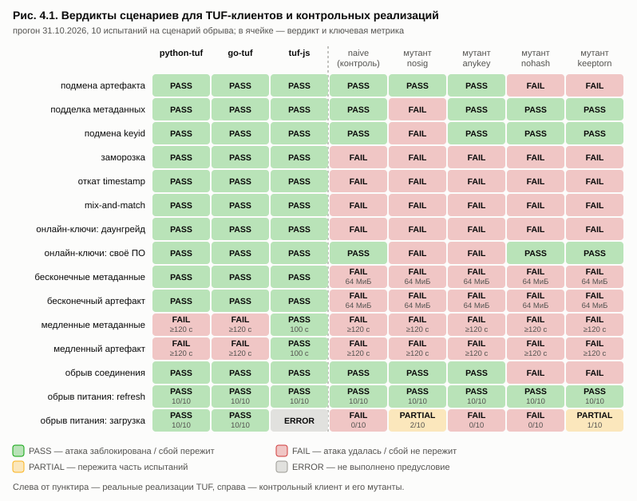
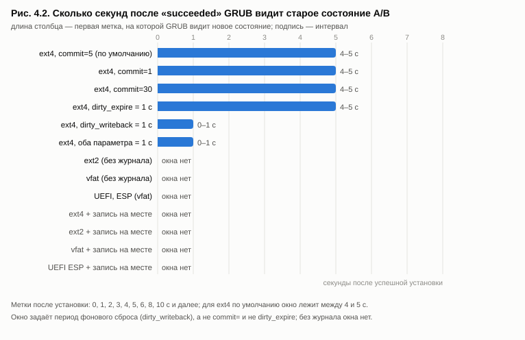
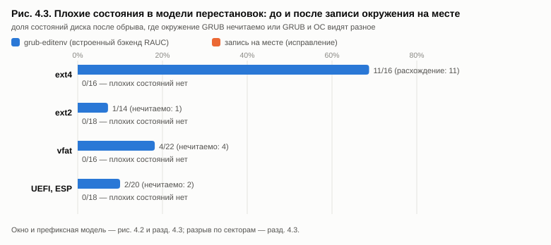

# Глава 4. Экспериментальная апробация

В главе 2 описан метод оценки, в главе 3 — его реализация в стенде otabench. В этой главе стенд применён к реальным системам обновления двух классов: к четырём клиентам TUF и обработчику манифестов SUIT (клиентский контур) и к A/B-апдейтерам RAUC и SWUpdate с загрузчиком GRUB (системный контур). У апробации две цели. Первая — проверить сам метод: различают ли сценарии реализации, обнаруживают ли оракулы заведомые дефекты и какие модели сбоя нужны, чтобы эффект вообще стал виден. Вторая — получить содержательные результаты об испытанных системах: какие классы угроз у них закрыты, где реализации одной спецификации расходятся и в каких конфигурациях обрыв питания нарушает инварианты п. 2.4.7.

Все эксперименты выполнены 31.10–01.11.2026 на одном хосте. Метод и реализация здесь не пересказываются, на них даются ссылки. Числа взяты из сырых файлов результатов (`results.json`, `pilot.json`). Если число есть только в журнале экспериментов проекта (`docs/pilot-ab.md`, `docs/mvp-results.md`), это оговорено.

## 4.1 Объекты и условия экспериментов

### 4.1.1 Испытуемые системы

Объекты испытаний перечислены в табл. 4.1. Клиенты TUF подключены по протоколу tuf-conformance (п. 3.2.1), сам набор зафиксирован коммитом `3d3fbb8` (табл. 3.16). Контрольный клиент и мутанты описаны в п. 3.4, A/B-апдейтер — в п. 3.5.

*Таблица 4.1 — Объекты испытаний*

| Система | Версия | Язык | Роль | Подключение |
|---|---|---|---|---|
| python-tuf (ngclient) | 7.0.1 | Python | реализация TUF | клиент `python_tuf.py` из tuf-conformance |
| go-tuf | v2.4.2 | Go | реализация TUF | клиент из каталога `clients/go-tuf` tuf-conformance |
| tuf-js | 6.0.1 | TypeScript, Node.js | реализация TUF | собственный адаптер `client.js` (66 строк) |
| naive | — | Python | контрольный клиент (п. 3.4.1) | тот же протокол |
| naive-nosig, naive-anykey, naive-nohash, naive-keeptorn | — | Python | мутанты (табл. 3.8) | `OTABENCH_MUTANT` = `sig`, `role-keys`, `hash`, `keep-torn` |
| tough | 0.24.0 | Rust | реализация TUF | собственный адаптер `clients/tough/` (105 строк), только в Linux-образе |
| libcsuit | коммит `00f5609` | C | обработчик манифестов SUIT | пример `examples/process` с тремя правками (п. 4.2.9) |
| RAUC + GRUB | RAUC 1.8 (пакет Debian 12), GRUB 2.06 | C | A/B-апдейтер и загрузчик | адаптер `rauc-grub` (п. 3.2.2); гость Debian 12.15, ядро 6.1.0-54 |
| RAUC 1.15.2 + GRUB | 1.15.2 (релизный архив) | C | A/B-апдейтер | адаптер `rauc1.15.2-grub` (наследует `rauc-grub`) |
| SWUpdate + GRUB | 2024.12.1 (bookworm-backports) | C | A/B-апдейтер | адаптер `swupdate-grub` |
| naive-rauc-grub | — | shell | контрольный установщик: проверка подписи, затем повторное открытие бандла (п. 3.5.4) | адаптер, наследует `rauc-grub` |

A/B-апдейтер испытан в двух вариантах загрузки. В варианте **BIOS** GRUB для i386-pc читает `grub.cfg` и `grubenv` с отдельного раздела `/boot-ab` (табл. 3.11). В варианте **UEFI** система загружается через OVMF, неподписанный GRUB для x86_64-efi стоит на настоящем разделе EFI (vda15, vfat), а `grubenv` лежит на этом разделе, как советует документация RAUC для UEFI-систем [191]. Во всех вариантах, кроме `*-inplace`, используется встроенный GRUB-обработчик RAUC (`bootloader=grub`). В вариантах `*-inplace` его заменяет обработчик с записью на месте (`bootloader=custom`, п. 3.7.2). Бандлы `v1`, `v2`, `v2-broken` и `v2-attacker` весят по 273 МБ (п. 3.5.4).

Роль контрольных реализаций для A/B-апдейтера играют конфигурации (п. 2.3.4), а для сценария TOCTOU — установщик `naive-rauc-grub`. Для RAUC 1.8 испытано 13 вариантов из табл. 3.15 и ещё два варианта защиты работающего слота (`ext4-inplace-rootro`, `ext4-inplace-fsck`, п. 4.3.10); для RAUC 1.15.2 добавлены `minver` и `stream`, для SWUpdate — `nodowngrade`. Варианты табл. 3.15: `ext4-c5` (исходный), `ext4-c1`, `ext4-c30`, `ext4-wb1`, `ext4-wbonly`, `ext4-exponly`, `ext2`, `vfat`, `ext4-inplace`, `ext2-inplace`, `vfat-inplace`, `uefi-esp`, `uefi-esp-inplace`. Варианты без журнала (`ext2`, `vfat`) служат контролем специфичности для окна после сообщения об успехе и контролем чувствительности для порчи окружения. Варианты `*-inplace` служат контролем специфичности для исправления.

### 4.1.2 Хост и окружение

Хост: Windows 11 Pro (сборка 10.0.26200), AMD Ryzen 5 3600, 32 ГБ ОЗУ. Клиентский контур работал под Python 3.13.15, Go 1.27.1 и Node.js 24.19.0. Системный контур использовал QEMU 11.1 для Windows с ускорителем WHPX. KVM на этом хосте недоступен, в том числе в WSL. Гость получал 1 ГиБ памяти, 2 процессора и диск virtio-blk (п. 3.5.1). Все перезагрузки гостя эмулированы холодным стартом (п. 3.5.5). Это ограничение внешней валидности, оно обсуждается в п. 4.5.3.

### 4.1.3 Параметры прогонов

Параметры приведены в табл. 4.2. Для клиентского контура они записаны в поле `params` файла `results.json`. Файл `pilot.json` параметров командной строки не сохраняет (п. 3.8.3). Поэтому для системного контура параметры восстановлены по фактическим данным в файлах: числу точек, сетке меток и размеру области.

*Таблица 4.2 — Параметры прогонов*

| Контур | Параметр | Значение |
|---|---|---|
| клиентский | сценарии × клиенты | 16 (базовый и 15 сценариев) × 8 = 128 ячеек |
| | испытаний на сценарий сбоя, зерно | $n = 10$, зерно 1 |
| | лимиты стенда | бесконечные данные: 64 МиБ и 30 с; медленная отдача: 120 с |
| | скорость медленной отдачи | 2 Б/с (метаданные), 64 Б/с (артефакт); длина артефакта 13 312 Б |
| | обрыв процесса | при обновлении метаданных задержка $U[0;\ 0{,}03]$ с после ответа; при загрузке артефакта 2 МиБ со скоростью 1,5 МиБ/с — $U[0{,}05;\ 1{,}5]$ с (п. 3.4.3) |
| | параллельность, длительность | 10 потоков (журнал `full-run-v2.log`); около 4 мин от отметки начала до записи `results.json` |
| системный | `crash-replay` | 45 точек: барьеры, равномерная выборка записей и метки +0, 2, 4, 6, 8, 10, 20, 30 с после успеха; 4 проверки живучести |
| | `window:*` | метки +0, 1, …, 6, 8, 10, 15, 20, 30 с (в серии 31.10 также +25, 35, 45 с); полный перебор области $R = 24$ записей перед завершением установки |
| | `reorder:*` | та же область; ограниченный набор подмножеств, $|V'| \le 8$ (п. 2.4.4); с флагом `--torn` дополнительно $k \in \{1, \lfloor n/2 \rfloor\}$ секторов (п. 3.6.6) |
| | готовность (I1) | 120 с для состояния после сбоя (табл. 3.4) |

### 4.1.4 Каталоги результатов

Каждому эксперименту соответствует свой каталог (табл. 4.3). Каталоги системного контура названы по времени запуска.

*Таблица 4.3 — Размещение результатов (`bench/results/`)*

| Каталог | Содержимое | Раздел |
|---|---|---|
| `full-2026-10-31/` | первый прогон MVP: 4 клиента × 16 сценариев, 64 ячейки | 4.5.4 |
| `full-2026-10-31-v2/` | основной прогон MVP: 8 клиентов, 128 ячеек; `results.json`, `matrix.md`, `matrix.html`, `matrix.csv` | 4.2 |
| `pilot-ab-20261031-223425/` | `happy`, `attacker`, `broken`, `broken-unconfirmed`, `cut-firstboot`, `cut-unconfirmed`, `downgrade`; предварительный `crash-replay` (32 точки) | 4.3.1 |
| `pilot-ab-20261031-225918/` | итоговый `crash-replay`: 45 точек, 4 проверки живучести | 4.3.2 |
| `pilot-ab-20261031-232023-window-v1/` | `window`: `ext4-c5`, `ext4-c1`, `ext4-c30`, `ext2`; `ext4-wb1` — ERROR | 4.3.3 |
| `pilot-ab-20261101-003715/` | `window:ext4-wb1` (повтор) | 4.3.3 |
| `pilot-ab-20261101-103655/` | `window:vfat`; `reorder`: `ext4-c5`, `ext2`, `vfat` | 4.3.3, 4.3.4 |
| `pilot-ab-20261101-105531/` | `window`: `ext4-wbonly`, `ext4-exponly` | 4.3.3 |
| `pilot-ab-20261101-110921/` | `happy:ext4-inplace` | 4.3.7 |
| `pilot-ab-20261101-111300/` | `window` и `reorder` для `ext4-`, `ext2-`, `vfat-inplace`; `happy:ext2-inplace`, `happy:vfat-inplace` | 4.3.7 |
| `pilot-ab-20261101-124934/` | `happy:uefi-esp` | 4.3.6 |
| `pilot-ab-20261101-125344/` | `window` и `reorder` для `uefi-esp`, `uefi-esp-inplace`; `happy:uefi-esp-inplace` | 4.3.6, 4.3.7 |
| `pilot-ab-20261101-132748/` | `reorder --torn`: `ext4-c5`, `vfat`, `ext4-inplace`, `vfat-inplace`, `uefi-esp-inplace` | 4.3.8 |
| `full-2026-11-01-v3/` | MVP v3: 9 клиентов (с `naive-lazyroot`), 144 ячейки; событийные точки в `powercut-refresh` | 4.2.4, 4.2.5 |
| `threat-matrix-2026-11-01/` | сводная матрица «угроза × реализация» обоих уровней (`otabench threats`) | 4.4.1 |
| `pilot-ab-20261101-171703/` | проверка адаптера v2: системные сценарии, `reorder:ext2`, `happy:vfat-inplace`, `happy:uefi-esp-inplace` | 4.3.1, 4.5.1 |
| `pilot-ab-20261101-173621/`, `-173816/` | `broken-unconfirmed`, `cut-unconfirmed` с детерминированным предусловием | 4.3.1, 4.5.1 |

Проверки живучести из отдельных восстановленных состояний (`replay_state.py`, п. 3.6.7) в виде JSON не сохранялись. Их результаты (п. 4.3.5, 4.3.6) взяты из журнала экспериментов `docs/pilot-ab.md`. Эталонные журналы записей, по которым эти состояния можно восстановить повторно, сохранены (п. 3.8.1).

## 4.2 Матрица «угроза × реализация» для TUF-клиентов (MVP)

### 4.2.1 Вердикты

Вердикты основного прогона показаны в табл. 4.4 и на рис. 4.1. Для краткости в таблице приведены только реальные клиенты и контрольный клиент. Мутанты разобраны в п. 4.2.5. Вердикты понимаются по табл. 2.6.

*Таблица 4.4 — Вердикты сценариев клиентского контура (`full-2026-10-31-v2`)*

| Сценарий | Угрозы | python-tuf | go-tuf | tuf-js | naive |
|---|---|---|---|---|---|
| `baseline` | — | PASS | PASS | PASS | PASS |
| `arb-target-substitution` | OTA-AUTH-01 | PASS | PASS | PASS | PASS |
| `arb-metadata-tamper` | OTA-AUTH-02 | PASS | PASS | PASS | PASS |
| `arb-keyid-spoofing` | OTA-AUTH-03 | PASS | PASS | PASS | PASS |
| `freeze-expired-timestamp` | OTA-FRESH-01 | PASS | PASS | PASS | FAIL |
| `rollback-timestamp` | OTA-FRESH-02 | PASS | PASS | PASS | FAIL |
| `mix-and-match` | OTA-FRESH-03 | PASS | PASS | PASS | FAIL |
| `online-keys-downgrade` | OTA-KEY-01, OTA-FRESH-02 | PASS | PASS | PASS | FAIL |
| `online-keys-arbitrary` | OTA-KEY-02, OTA-AUTH-01 | PASS | PASS | PASS | PASS |
| `endless-metadata` | OTA-DOS-01 | PASS | PASS | PASS | FAIL |
| `endless-artifact` | OTA-DOS-02 | PASS | PASS | PASS | FAIL |
| `slow-metadata` ⚡ | OTA-DOS-03 | FAIL | FAIL | PASS | FAIL |
| `slow-artifact` ⚡ | OTA-DOS-04 | FAIL | FAIL | PASS | FAIL |
| `dropped-connection` | OTA-NET-01 | PASS | PASS | PASS | PASS |
| `powercut-refresh` | OTA-PWR-01 | PASS | PASS | PASS | PASS |
| `powercut-download` | OTA-PWR-02 | PASS | PASS | ERROR | FAIL |

⚡ — дифференциальная находка (п. 2.3.5): реальные реализации одной спецификации расходятся.

*Рисунок 4.1 — Матрица «угроза × реализация» прогона MVP (`full-2026-10-31-v2`): 16 сценариев × 8 клиентов, включая контрольный клиент и четыре мутанта*

Из матрицы видны три закономерности.

1. **Контрольный клиент проваливает ровно те сценарии, для которых в нём нет защиты.** У `naive` нет проверки сроков, монотонности версий, ограничений длины и атомарной записи (п. 3.4.1). Он получил FAIL в сценариях заморозки, отката, смешивания метаданных, понижения версии через онлайн-ключи, бесконечных данных, медленной отдачи и обрыва при загрузке. Подписи и хэш он проверяет, и в `arb-*` и `online-keys-arbitrary` получил PASS. Это основной довод в пользу валидности оракулов: стенд выносит FAIL там, где дефект есть по построению, и не выносит там, где его нет.
2. **Реальные клиенты различаются только в двух сценариях**, `slow-metadata` и `slow-artifact` (п. 4.2.6).
3. **Обрыв процесса во время обновления метаданных пережили все, включая `naive`**, а обрыв во время загрузки артефакта контрольный клиент не пережил ни разу (п. 4.2.4).

Базовый сценарий у всех восьми клиентов получил PASS, то есть предусловия честного пути выполнены. Вердикты всех 64 ячеек реальных и контрольного клиентов в первом прогоне (`full-2026-10-31`) совпали с основным прогоном.

### 4.2.2 Доли блокируемых атак и выдержанных сбоев

Доли $BR(c)$ (п. 2.5.1) посчитаны по общему набору $S^{*}$ из 14 сценариев. Сценарий `powercut-download` исключён для всех клиентов, потому что tuf-js получил в нём ERROR. Атаки (12 сценариев) и сбои (`dropped-connection`, `powercut-refresh`) считаются раздельно (п. 3.4.4). Результаты приведены в табл. 4.5.

*Таблица 4.5 — Доли по общему набору сценариев (PARTIAL = 0,5)*

| Клиент | Атак отражено | $BR$ (атаки) | Сбоев выдержано | $BR$ (сбои) |
|---|---|---|---|---|
| python-tuf | 10 из 12 | 83% | 2 из 2 | 100% |
| go-tuf | 10 из 12 | 83% | 2 из 2 | 100% |
| tuf-js | 12 из 12 | 100% | 2 из 2 | 100% |
| naive (контроль) | 4 из 12 | 33% | 2 из 2 | 100% |
| naive-nosig | 1 из 12 | 8% | 2 из 2 | 100% |
| naive-anykey | 3 из 12 | 25% | 2 из 2 | 100% |
| naive-nohash | 3 из 12 | 25% | 1 из 2 | 50% |
| naive-keeptorn | 3 из 12 | 25% | 1 из 2 | 50% |

Разница между python-tuf и go-tuf (83%) с одной стороны и tuf-js (100%) с другой целиком объясняется двумя сценариями медленной отдачи. Вывод «tuf-js защищён лучше» из этого не следует. PASS у tuf-js зависит от порога стенда 120 с (п. 4.5.2), а сам сценарий относится к угрозе, которую TUF 1.0.37 не требует отражать (п. 2.2.4). Доли сбоев у реальных клиентов одинаковы. Мутанты `naive-nohash` и `naive-keeptorn` теряют половину из-за `dropped-connection`.

### 4.2.3 Атаки на ресурсы: время до прерывания и объём

Для сценариев бесконечных данных и медленной отдачи публикуются сырые метрики $T_{abort}$ и $B$ (п. 2.5.2). Объём $B$ считает сервер (`bytes_pushed`, п. 3.3.4), поэтому в него входят и данные, осевшие в буферах сокетов. Значения приведены в табл. 4.6.

*Таблица 4.6 — Время до прерывания $T_{abort}$ и объём $B$, отданный сервером*

| Сценарий | python-tuf | go-tuf | tuf-js | naive |
|---|---|---|---|---|
| `endless-metadata` | 0,64 с; 960 КиБ | 0,10 с; 320 КиБ | 0,32 с; 768 КиБ | 0,89 с; 64 МиБ (лимит) |
| `endless-artifact` | 0,64 с; 832 КиБ | 0,12 с; 448 КиБ | 0,40 с; 448 КиБ | 0,69 с; 64 МиБ (лимит) |
| `slow-metadata`, 2 Б/с | ≥ 120 с (120,64); 240 Б | ≥ 120 с (120,22); 240 Б | 100,28 с; 200 Б | ≥ 120 с (120,52); 240 Б |
| `slow-artifact`, 64 Б/с | ≥ 120 с (120,39); 7445 Б | ≥ 120 с (120,08); 7446 Б | 100,17 с; 6205 Б | ≥ 120 с (120,28); 7456 Б |

Цензурированные значения записаны как «≥ 120 с», в скобках указано фактическое время срабатывания лимита. Подписанная длина артефакта равна 13 312 Б.

Бесконечные данные все реальные клиенты прервали сами за 0,10–0,64 с. Сервер успел отдать им 320–960 КиБ, намного меньше лимита 64 МиБ. В `endless-artifact` файл длиннее подписанной длины ни у одного реального клиента не сохранился. Контрольный клиент принял все 64 МиБ: передачу остановил лимит стенда.

При медленной отдаче python-tuf и go-tuf до лимита 120 с не прервались. За это время они приняли 240 Б метаданных или 7445–7446 Б артефакта из 13 312 Б. tuf-js прервал передачу через 100,17–100,28 с. Причины разобраны в п. 4.2.6.

### 4.2.4 Сбои: обрыв соединения и обрыв процесса

Метрики сценариев сбоя приведены в табл. 4.7. Выживаемость дана с 95% интервалом Уилсона (п. 2.5.3). Рядом указано, сколько испытаний фактически прервано (`crashed`): по п. 3.4.3 эта величина публикуется отдельно от числа испытаний.

*Таблица 4.7 — Сценарии сбоя клиентского контура*

| Сценарий | Метрика | python-tuf | go-tuf | tuf-js | naive |
|---|---|---|---|---|---|
| `dropped-connection` | исход; $T_{rec}$ | восстановлен; 0,436 с | восстановлен; 0,068 с | восстановлен; 0,255 с | восстановлен; 0,304 с |
| `powercut-refresh` | $k/n$ [ДИ] | 10/10 [72%; 100%] | 10/10 [72%; 100%] | 10/10 [72%; 100%] | 10/10 [72%; 100%] |
| | прервано фактически | 10 | 2 | 10 | 3 |
| | $T_{rec}$ | 0,423 с | 0,067 с | 0,196 с | 0,328 с |
| `powercut-download` | $k/n$ [ДИ] | 10/10 [72%; 100%] | 10/10 [72%; 100%] | ERROR | 0/10 [0%; 28%] |
| | прервано фактически | 10 | 10 | — | 10 |
| | $T_{rec}$; оборванный файл | 0,417 с; 0 | 0,076 с; 0 | — | не определено; 10 из 10 |

**Обрыв во время обновления метаданных** пережили все клиенты, включая контрольный. Результат 10 из 10 подтверждает выживаемость не ниже примерно 72%, а не «100%». Прогон v3 (`results/full-2026-11-01-v3/`, 9 клиентов, 144 ячейки) перевёл `powercut-refresh` на перебор событийных точек (п. 2.4.2): холостое обновление с ротацией root делает 5 запросов (`2.root.json`, `3.root.json`, `timestamp.json`, `3.snapshot.json`, `3.targets.json`), каждый обрывается в трёх фазах — 15 точек. Все три реальных клиента пережили 15 из 15, и теперь их действительно прерывали: python-tuf и tuf-js в 13 точках, go-tuf в 12 (остальные — фазы «после ответа» на последнем запросе, когда клиент успевает завершиться). Новый мутант `naive-lazyroot` (доверенный root удаляется в начале ротации и записывается в конце) пойман в обоих сохранённых прогонах (`results/b1-powercut-refresh-events/` и v3) в детерминированной точке «при запросе `3.root.json`»; в первом из них — ещё и в точке «через 10 мс после ответа `2.root.json`». Запись на месте у `naive` рвёт `root.json` лишь случайно: в v3 так получил FAIL `naive-nosig` в фазе «через 10 мс после ответа `2.root.json`», остальные варианты `naive` эту точку пережили. Вердикты остальных ячеек совпали с прогоном v2. Это перепись точек, поэтому интервал не приводится, а одна непережитая точка даёт FAIL (табл. 2.6). Ниже — исходные данные прогона v2. У go-tuf фактически прервано только 2 испытания из 10, у `naive` — 3. Эти клиенты успевают завершить обновление раньше, чем срабатывает таймер обрыва (задержка $U[0;\ 0{,}03]$ с). Доказательная сила результата для них меньше, чем показывает интервал по десяти испытаниям (п. 4.5.1).

**Обрыв во время загрузки артефакта** python-tuf и go-tuf пережили во всех десяти испытаниях, и все десять были фактически прерваны. Контрольный клиент не пережил ни одного. После каждого обрыва в каталоге целей оставался оборванный `fw.bin`, а повторный запуск завершался с кодом 0 и оставлял тот же файл. Примеры из журнала: 688 128 Б, 1 900 544 Б, 1 310 720 Б вместо 2 МиБ. Причина в построении контрольного клиента: он пишет поток сразу в итоговый файл, а существующий файл считает кэшем и не перепроверяет (п. 3.4.1). Это именно тот дефект уровня приложения, который модель уровня процесса способна найти (п. 2.4.2).

У tuf-js сценарий `powercut-download` получил ERROR. Под Node.js 24.19.0 на Windows клиент аварийно завершался на *честной* загрузке 2 МиБ без всякого сбоя: `Assertion failed: !(handle->flags & UV_HANDLE_CLOSING), file src\win\async.c, line 94`. Сработало предусловие (Р10), и дефект платформы не был принят за свойство клиента. Вердикта по OTA-PWR-02 для tuf-js в этом прогоне нет. Позже выяснилось, что сбой провоцировал сам стенд (п. 4.2.8): сервер отвечал по HTTP/1.0 и закрывал соединение после каждого ответа, а HTTP-клиент Node.js падал на утверждении, когда соединение закрывалось во время притормаживания чтения. После перехода сервера на HTTP/1.1 с keep-alive tuf-js пережил все 10 обрывов на Windows и Linux.

### 4.2.5 Мутационный анализ стенда

Для каждого сценария найдено множество контрольных реализаций, которые он «убивает», то есть получает для них FAIL или PARTIAL (п. 2.3.4). Результат приведён в табл. 4.8.

*Таблица 4.8 — Какие контрольные реализации убивает каждый сценарий*

| Сценарий | Убитые контрольные реализации |
|---|---|
| `arb-target-substitution` | naive-nohash, naive-keeptorn |
| `arb-metadata-tamper` | naive-nosig |
| `arb-keyid-spoofing` | naive-nosig |
| `online-keys-arbitrary` | naive-nosig, naive-anykey |
| `dropped-connection` | naive-nohash, naive-keeptorn |
| `freeze-expired-timestamp`, `rollback-timestamp`, `mix-and-match`, `online-keys-downgrade`, `endless-metadata`, `endless-artifact`, `slow-metadata`, `slow-artifact`, `powercut-download` | naive и все четыре мутанта |
| `powercut-refresh` | **никого** (v2); в v3 с событийными точками — `naive-lazyroot` детерминированно и один из вариантов `naive` случайно |

Хотя бы одну контрольную реализацию убивают 14 сценариев из 15 в прогоне v2 и все 15 в прогоне v3. В первом прогоне, без мутантов, шесть сценариев проходили все четыре клиента: три сценария `arb-*`, `online-keys-arbitrary`, `dropped-connection` и `powercut-refresh`. Для пяти из них мутанты показали, что сценарий способен обнаружить дефект, который в него заложен. Сверх дефектов `naive` каждый мутант убит ровно теми сценариями, которые ожидались по табл. 3.8. Например, `naive-anykey` принимает подпись любым ключом из root, и сверх набора `naive` его убивает только подпись targets чужой ролью (`online-keys-arbitrary`). В `powercut-download` мутанты `naive-nosig` и `naive-keeptorn` получили PARTIAL: 2 из 10 [6%; 51%] и 1 из 10 [2%; 40%], при 9 фактических обрывах у каждого.

Единственный сценарий без улова в v2 — `powercut-refresh` со случайной задержкой. Мелкие файлы метаданных пишутся одним вызовом, а завершение процесса не теряет страничный кэш ОС. Поэтому даже клиент, который пишет на месте без fsync и переименования, этот сценарий переживает. Перебор событийных точек (v3) находит дефект, окно которого охватывает сетевой запрос (`naive-lazyroot`), а окно внутри одного вызова записи — только случайно. Это прямое эмпирическое обоснование уровней блочных записей и системы (п. 2.4.2–2.4.5): без них свойство OTA-PWR-01 стенд фактически не проверяет. Следующий шаг мутационного анализа — добавить к мутантам заведомо уязвимые версии реальных клиентов как известную истину. Пример — версии go-tuf до исправления CVE-2024-47534 и CVE-2026-23992.

### 4.2.6 Дифференциальная находка: медленная отдача

Три реализации одной спецификации по-разному реагируют на отдачу со скоростью 2 Б/с (метаданные) и 64 Б/с (артефакт). По данным журнала экспериментов (`docs/mvp-results.md`), механизмы установлены по исходному коду клиентов.

* **python-tuf** ограничивает только паузу между байтами: `socket_timeout=30` в `urllib3_fetcher.py`. При 2 Б/с пауза составляет 0,5 с, и этот таймаут не срабатывает.
* **go-tuf** за 120 с не прервался. Механизм в работе не разбирался.
* **tuf-js** прервался примерно через 100 с по общему таймауту запроса `fetchTimeout: 100000`, реализованному через `AbortSignal.timeout`.

Практический масштаб показывает оценка из журнала экспериментов. При 2 Б/с и ограничении длины snapshot около 2 МБ (значение go-tuf по умолчанию) загрузка заняла бы порядка 11 суток. Всё это время клиент «заморожен» и не сообщает ни об одной ошибке.

**Нормативный статус** (п. 2.2.4). Угрозу slow retrieval удалили из целей TUF в версии 1.0.7: коммит `f9122f1` от 08.09.2020, PR #111. В TUF 1.0.37 её нет ([3]). Uptane Standard 2.1.0 называет атаку в §4.3.2, а §5.4 требует: «All ECUs SHALL monitor the download speed of image metadata and image binaries to detect and respond to a slow retrieval attack» ([4, 41]). Поэтому FAIL у python-tuf и go-tuf **не является нарушением текущей спецификации TUF**. Он означает две вещи: (а) расхождение реализаций одной спецификации и (б) невыполненное требование Uptane для систем, которые строят Uptane-клиента поверх этих библиотек.

**Позиция мейнтейнеров** (проверено 01.11.2026). Для python-tuf это задокументированное проектное решение, а не дефект. Обсуждение python-tuf#932 «Reinstate full protection against slow retrieval attacks» закрыто 20.02.2025 [194]. Мейнтейнеры пояснили: открытое обсуждение создаёт впечатление, будто универсальная библиотека способна защитить от медленной отдачи, а это не так. Библиотека не может отличить атаку от медленной сети или слабого процессора, и тем, кому защита нужна, предлагается написать собственный загрузчик (fetcher). Ответственность, таким образом, перенесена на интегратора. Стенд показывает именно её цену: в Uptane-развёртывании поверх python-tuf или go-tuf требование §5.4 само собой не выполнится.

Из этого следует, как использовать находку. Сообщать о ней в python-tuf и go-tuf как о дефекте не нужно. Черновик предложения для tuf-conformance (п. 4.4.5) содержит только бесконечные данные и обрыв передачи, где требование спецификации однозначно. Медленную отдачу он намеренно оставляет вне проверок «прошёл / не прошёл». PASS у tuf-js тоже не означает «защищён»: общий таймаут 100 с оказался меньше порога стенда, и при другом пороге вердикт мог бы быть иным.

### 4.2.7 Сценарии, добавленные после основного прогона

После основного прогона стенд получил пять сценариев для угроз каталога, которые раньше не покрывал никто (`results/d1-new-scenarios/`), и сценарий для класса дефектов, который чаще других встречается в уязвимостях клиентов TUF (табл. 4.8а).

*Таблица 4.8а — Новые сценарии клиентского контура*

| Сценарий | Угроза | python-tuf | go-tuf | tuf-js | naive | мутанты, получившие FAIL |
|---|---|---|---|---|---|---|
| `online-keys-freeze`: свежие подписи онлайн-ключей указывают на истёкший targets | OTA-KEY-04 | PASS | PASS | PASS | FAIL | все шесть вариантов `naive` |
| `mirror-errors`: единственное зеркало отвечает 503 | OTA-DOS-05 | PASS, 0,40 с | PASS, 0,06 с | PASS, 3,26 с | PASS | — |
| `drop-requests`: соединение закрывается без ответа | OTA-DOS-06 | PASS, 0,64 с | PASS, 0,20 с | PASS, 3,20 с | PASS | — |
| `extra-data-artifact`: после подписанного образа дописаны байты | OTA-AUTH-04 | PASS | PASS | PASS | PASS | `naive-nohash`, `naive-keeptorn` |
| `unsupported-spec-version`: подписанный timestamp с `spec_version` 2.0.0 | OTA-PARSE-02 | PASS | **FAIL** | PASS | PASS | — |
| `timestamp-same-version`: timestamp той же версии с другим содержимым | OTA-FRESH-02 | PASS | PASS | PASS | FAIL | — |
| `threshold-key-twice`: один ключ snapshot записан в root под двумя keyid, порог 2 | OTA-AUTH-03 | **FAIL** | PASS | **FAIL** | FAIL | все проверенные варианты `naive` |

Сценарий `timestamp-same-version` (`results/d2-timestamp-same-version/`) проверяет правило версий, которое различается между спецификациями: TUF 1.0.37 (§5.4.3.1) требует строго большей версии timestamp, а при равной — остановить обновление без ошибки и оставить доверенный файл; полная проверка Uptane 2.1.0 (§5.4.4.4) равную версию допускает. Все три клиента держат правило TUF, контрольный клиент его нарушает. Различие правил записано в каталоге (поле `spec_status` угрозы OTA-FRESH-02).

Сценарии недоступности зеркала (`mirror-errors`, `drop-requests`) проверяют только то, что клиент сообщает об отказе за ограниченное время и не портит доверенное хранилище: переключиться на другое зеркало протокол CLI не позволяет. Поэтому их проходят и контрольные реализации, и в мутационном анализе эти два сценария пока никого не убивают.

**Дифференциальная находка: `spec_version`.** go-tuf v2.4.2 принял корректно подписанный timestamp с `"spec_version": "2.0.0"` и сохранил его как доверенный; python-tuf 7.0.1 и tuf-js 6.0.1 его отклонили. Спецификация TUF 1.0.37 требует: «clients MUST verify that "spec_version" matches the expected version number», допуская сравнение только мажорной версии [3]. В исходном коде go-tuf v2.4.2 и ветки `master` поле `spec_version` записывается при создании и сериализации метаданных, но нигде не сравнивается при загрузке, тогда как python-tuf сравнивает мажорную версию (`tuf/api/_payload.py`). В tuf-conformance теста на это требование нет. Опасность низкая: такие метаданные всё равно должны быть подписаны ключом роли; требование важно для совместимости с будущими несовместимыми версиями спецификации. Черновик issue — `docs/upstream/go-tuf-spec-version-draft.md`, предложенный тест добавлен в черновик для tuf-conformance; оба не опубликованы.

**Дифференциальная находка известного класса: один ключ под двумя keyid.** Root v2 перечисляет один и тот же открытый ключ роли snapshot дважды — под верным keyid и под произвольным — и задаёт порог 2; snapshot подписан одним ключом под обоими идентификаторами (`results/d2-threshold-key-twice/`). go-tuf v2.4.2 его отклоняет: подписи считаются по хэшу самого ключа, а не по keyid. python-tuf 7.0.1 и tuf-js 6.0.1 засчитывают одну подпись дважды и принимают snapshot. Спецификация TUF 1.0.37 требует, чтобы каждый ключ давал в порог не больше одной подписи и чтобы клиент вычислял keyid. Тот же класс в go-tuf до версии 0.3.2 был опубликован как уязвимость низкой опасности (GHSA-3633-5h82-39pq, 2022). Разработчики python-tuf придерживаются TAP 12, где keyid непрозрачен, и пункт TAP 12 о проверке уникальности ключей оставили на усмотрение делегирующей роли (обсуждение python-tuf#1084); смягчить требование вычислять keyid предлагается в specification#305. Поэтому это расхождение реализаций с задокументированными позициями сторон, а не новая уязвимость: атака требует, чтобы делегирующая роль сама занесла ключ дважды. В tuf-conformance есть тест на повтор одного keyid (`test_duplicate_keys`), но не на один ключ под разными keyid; предложение добавлено в черновик для tuf-conformance.

### 4.2.8 Итоговый прогон на Windows и Linux

Итоговый прогон клиентского контура выполнен после всех исправлений стенда на двух платформах: Windows 11 (`results/full-2026-11-01-v4/`) и Linux в Docker-образе стенда (`results/full-linux-2026-11-01-v4/`): 21 сценарий, 9 реализаций, 189 ячеек. Вердикты совпали в 188 ячейках. Единственное расхождение — у контрольного мутанта `naive-keeptorn` в `powercut-download` (PARTIAL 1 из 10 против FAIL 0 из 10): точки обрыва там выбираются случайно.

*Таблица 4.8б — Доли по общему набору в итоговом прогоне (одинаковы на обеих платформах)*

| Клиент | Атаки заблокированы | Сбои пережиты | Непройденные сценарии |
|---|---|---|---|
| python-tuf 7.0.1 | 15 из 17 (88%) | 3 из 3 | `slow-metadata`, `slow-artifact` |
| go-tuf v2.4.2 | 14 из 17 (82%) | 3 из 3 | `slow-metadata`, `slow-artifact`, `unsupported-spec-version` |
| tuf-js 6.0.1 | 17 из 17 (100%) | 3 из 3 | — |

Сценарий `threshold-key-twice` выполнен отдельно (п. 4.2.7) и в доли не входит. Первый прогон в Linux нашёл две ошибки стенда, незаметные на Windows (табл. 4.20): поздний обрыв попадал в следующий прогон быстрого клиента, а сервер на HTTP/1.0 провоцировал сбой HTTP-клиента Node.js. Оба исправления внесены до итогового прогона. Совпадение вердиктов на двух ОС с разными примитивами завершения процесса (TerminateProcess и SIGKILL) и разными ФС показывает, что результаты клиентского контура не зависят от платформы хоста.

### 4.2.9 Третья экосистема: SUIT (libcsuit)

Профиль SUIT испытывает libcsuit (`kentakayama/libcsuit`, коммит `00f5609`, сборка с OpenSSL) — реализацию обработчика манифестов IETF SUIT на C. Адаптер (`bench/clients/suit-libcsuit/`) — пример `examples/process` из той же библиотеки с тремя правками: условия, которые пример не реализует (идентификаторы производителя, класса и устройства), засчитываются как выполненные; невыполненные условия больше не подавляются — пример подавляет их «для тестирования», и это поведение (`OTABENCH_SUPPRESS=1`) служит контрольной реализацией; пустой отчёт не передаётся печати. Артефакты — подписанные тестовые манифесты самой библиотеки; атаки стенд получает из них, ключ подписи ему не нужен (`results/suit-2026-11-01/`, табл. 4.8в).

*Таблица 4.8в — Профиль SUIT*

| Сценарий | Угроза | libcsuit (адаптер) | пример libcsuit (контроль) |
|---|---|---|---|
| `suit-baseline`: подлинный образ по манифесту expU | — | PASS | PASS |
| `suit-payload-substitution`: образ изменён, дайджест не совпадает | OTA-AUTH-01 | PASS | **FAIL** |
| `suit-manifest-tamper`: один байт манифеста | OTA-AUTH-02 | PASS | PASS |
| `suit-signature-tamper`: один байт подписи COSE | OTA-AUTH-02 | PASS | PASS |
| `suit-extra-data`: байты после образа | OTA-AUTH-04 | PASS (принят ровно подписанный размер) | PASS |
| `suit-malformed`: усечённый конверт и 20 случайных входов | OTA-PARSE-01 | **FAIL**: 6 из 21 «успешны» | **FAIL** |

Сценарий подмены образа различает реализацию и контроль: адаптер отклоняет образ с несовпадающим дайджестом, пример с подавленными условиями его принимает. Загрузка в манифесте expU пишет байты сразу в конечный компонент, поэтому после отказа подменённые байты там остаются — это решение автора манифеста, и интегратор не должен использовать компонент, по которому условие не выполнено.

Две находки в libcsuit. (1) На 6 из 21 испорченного входа `suit_process_envelope()` возвращает успех, ничего не обработав и с пустым отчётом, хотя пример-разборщик той же библиотеки на всех этих входах сообщает ошибку: устройство доложило бы об успешном обновлении, которого не было. (2) В исходном примере испорченный вход — даже один изменённый байт подписи — приводит к SIGSEGV: стандартный обработчик отчёта вызывает `suit_print_report()`, а та — `suit_judge_cose_tag_from_buf()`, которая читает первый байт пустого буфера без проверки (стек снят gdb). Опасность обеих низкая: код не исполняется, ничего не устанавливается. Черновик сообщения — `docs/upstream/libcsuit-draft.md`, не опубликован. Откат (OTA-FRESH-02) в профиль не вошёл: порядковый номер манифеста пример между запусками не хранит, и проверка зависит от интеграции.

### 4.2.10 Четвёртая реализация TUF: tough

tough 0.24.0 — библиотека TUF на Rust, которую использует Bottlerocket. Адаптер из 105 значимых строк (п. 3.2.1) собран в Linux-образе стенда, и на нём выполнен весь набор клиентского контура вместе с python-tuf и контрольным клиентом (`results/tough-linux-2026-11-01/`, 23 сценария).

*Таблица 4.8г — tough 0.24.0 на наборе клиентского контура (Linux)*

| Группа | Результат |
|---|---|
| Подлинность, свежесть, онлайн-ключи (`arb-*`, `freeze-*`, `rollback-*`, `mix-and-match`, `online-keys-*`) | PASS во всех |
| Бесконечные данные | PASS: прервано через 0,25 с (метаданные) и 0,58 с (артефакт) |
| Медленная отдача, 2 Б/с и 64 Б/с | PASS: прервано через 30,4 и 30,6 с — таймаут HTTP-транспорта библиотеки |
| Обрыв процесса: 15 событийных точек, 10 обрывов при загрузке | 15 из 15 и 10 из 10 пережито |
| `mirror-errors`, `drop-requests`, `extra-data-artifact`, `threshold-key-twice` | PASS |
| `unsupported-spec-version` | **FAIL**: метаданные со `spec_version` 2.0.0 приняты |
| `timestamp-same-version` | **FAIL**: timestamp той же версии с другим содержимым заменил доверенный |

Доля заблокированных атак у tough — 17 из 19 сценариев этого прогона, у python-tuf в том же прогоне — 16 из 19 (медленная отдача и `threshold-key-twice`). tough — единственный, кроме tuf-js, клиент, прерывающий медленную отдачу, и делает это быстрее. Две находки tough проверены по исходному коду. Функция загрузки timestamp требует лишь, чтобы старая версия была не больше новой (`old_timestamp.signed.version <= timestamp.signed.version`, комментарий ссылается на TUF 1.0.16), поэтому файл той же версии с другим содержимым становится доверенным. Поле `spec_version` хранится, но не сравнивается. Опасность обеих низкая: такие метаданные должны быть подписаны ключом роли. tough не входит в число клиентов, которые испытывает tuf-conformance, хотя тест на первое правило там есть (`test_timestamp_content_changes`). Черновик сообщения — `docs/upstream/tough-draft.md`, не опубликован.

### 4.2.11 Структурный фаззинг подписанных метаданных

Сценарий `fuzz-metadata` (OTA-PARSE-01) проверяет разбор и проверку метаданных за пределами подписи. Набор из 120 мутаций timestamp детерминирован и одинаков для всех клиентов: 16 значений (0, −1, $2^{31}$, $2^{63}$, $2^{64}$, $10^{30}$, строка вместо числа, пустая строка, строка 100 КБ, `true`, `null`, пустые список и объект, список глубины 500, строка с NUL, Unicode) в семи полях (`version`, `expires`, `spec_version`, `_type`, `meta`, `meta.snapshot.json`, `meta.snapshot.json.version`), удаление каждого из этих полей и неизвестное поле. Каждая мутация подписывается настоящим ключом timestamp, поэтому между ней и доверенным хранилищем стоят только разбор и проверки клиента. Падение (код возврата не 0 и не 1) или зависание дают FAIL; принятые мутации записываются и сравниваются между клиентами (`results/d5-fuzz-metadata/`, Windows; `d5-fuzz-linux/`, tough).

*Таблица 4.8д — Результаты структурного фаззинга (120 входов)*

| Клиент | Падения и зависания | Стали доверенными |
|---|---|---|
| python-tuf 7.0.1 | 0 | 9: неизвестное поле; версия $2^{31}$, $2^{63}$, $2^{64}$, $10^{30}$ в `version` и в `meta.snapshot.json.version` |
| go-tuf v2.4.2 | **4**: паника при отсутствии или `null` в `meta.snapshot.json`, при пустом или `null` `meta` | 7: неизвестное поле; версия $2^{31}$; любой `spec_version` (пустой, с NUL, «2», Unicode) |
| tuf-js 6.0.1 | 0 | 3: неизвестное поле; версия $2^{31}$ |
| tough 0.24.0 | 0 | 10: неизвестное поле; версия $2^{31}$ и $2^{63}$; любой `spec_version`, включая строку 100 КБ |
| naive (контроль) | 0 | 11, в том числе версия `true` |

Три наблюдения.

1. **Паника go-tuf.** Корректно подписанный timestamp без записи `snapshot.json` приводит к разыменованию нулевого указателя в `trustedmetadata.(*TrustedMetadata).UpdateTimestamp` (`trustedmetadata.go:144`, стек снят при воспроизведении) — процесс клиента завершается с кодом 2. Подписи к этому моменту уже проверены, поэтому нужен ключ timestamp или ошибочный репозиторий, но долгоживущий процесс обновления падает вместо того, чтобы сообщить об ошибке. В ветке `master` проверка добавлена 22.09.2026 (PR #743); клиент tuf-conformance, собранный с коммитом `923b304`, возвращает ошибку `meta is missing required "snapshot.json" entry`. Последний выпуск, v2.4.2, исправления не содержит. Это не новая уязвимость: исправление есть, его нужно выпустить (черновик — в `docs/upstream/go-tuf-spec-version-draft.md`).
2. **Предел версии у реализаций разный.** python-tuf принимает версии $2^{64}$ и $10^{30}$, tough — до $2^{63}$, go-tuf и tuf-js отклоняют уже $2^{63}$. Спецификация называет версию целым числом без ограничения. Держатель ключа timestamp может «перемотать» версию вперёд (OTA-FRESH-04) только в тех клиентах, которые принимают большие числа, а восстановление после такой атаки зависит от реализации.
3. **`spec_version`.** go-tuf и tough принимают любую строку, в том числе пустую и с нулевым символом, что подтверждает находку п. 4.2.7 для более широкого набора значений.

Первый прогон показал у tuf-js «зависание» на строках 100 КБ. Разбор показал, что библиотека отклонила вход (`Max length reached`), но процесс адаптера не завершался: недочитанное соединение keep-alive держало цикл событий, а адаптер выходил через `process.exitCode`. После правки адаптера (принудительный выход через 2 с после завершения работы) зависаний нет, сценарии `baseline`, `dropped-connection`, `endless-artifact` и `powercut-download` проходят как прежде (`results/d5-fuzz-tufjs/`). Это ещё один артефакт стенда, который мог бы стать ложной находкой (табл. 4.20).

Фаззинг здесь ограничен: одна роль, структурные мутации без обратной связи по покрытию, без повторов с разными зёрнами. По меркам SoK 2024 [131] это дифференциальная проверка устойчивости, а не оценка фаззера.

## 4.3 Уровень ОС: A/B-апдейтеры

Результаты системного контура в общую матрицу не попадают (Р2, п. 3.1.3). Сценарии получают вердикты по табл. 2.6, состояния после сбоя — классы по табл. 2.7. Выживаемость на блочном уровне дана в двух формах (п. 2.5.3): строгая $S_{OK}$ и форма безопасности $S_{safe}$. Точки выбраны систематически, поэтому результаты являются переписью выбранного множества, и интервалы для них не строятся.

### 4.3.1 Сценарии системного уровня

Сценарии системного уровня (табл. 4.9) проверяют штатный путь, подлинность, откат версии и откат на запасной слот при незагружаемом образе или обрыве питания во время первой загрузки.

*Таблица 4.9 — Сценарии системного уровня (`pilot-ab-20261031-223425`, BIOS, ext4)*

| Сценарий | Угроза | Вердикт | Наблюдения |
|---|---|---|---|
| `happy` | — | PASS | установка 15,6 с; от перезагрузки до готовности 11,0 с; B/v2 подтверждён и остаётся после второй перезагрузки |
| `attacker` | OTA-AUTH-01 | PASS | бандл, подписанный чужим ключом, отклонён (код 1); окружение загрузчика не изменено |
| `broken` | OTA-PWR-04 | PASS | корректно подписанный незагружаемый образ: B → паника ядра → A/v1 по штатной логике OK/TRY; 2 сброса, восстановление 22,4 с |
| `broken-unconfirmed` | OTA-PWR-04 | PASS, через RESCUE | то же, но установка начата до подтверждения A; 2 сброса, 22,3 с; 2 из 2 повторов с детерминированным предусловием — так же (21,2 и 23,0 с) |
| `cut-firstboot` | OTA-PWR-04 | PASS | обрыв питания во время первой неподтверждённой загрузки B → A/v1 по штатной логике; повторная установка → B/v2 |
| `cut-unconfirmed` | OTA-PWR-04 | PASS, через RESCUE | то же без подтверждения A; повторная установка → B/v2; 2 из 2 повторов — так же |
| `downgrade` | OTA-FRESH-02 | FAIL | на B/v2 бандл v1 принят и загружен (A/v1) |

Откат на запасной слот (инвариант I4) выполнен во всех четырёх сценариях. Однако в двух неподтверждённых вариантах подтверждённого запасного слота не было, и систему спасла только аварийная ветка `grub.cfg` (RESCUE → A, листинг 3.3) — правило стенда, а не логика апдейтера. Без второй пары сценариев (Р5) эта зависимость осталась бы невидимой.

Сценарий `downgrade` провален. В конфигурации по умолчанию RAUC 1.8 версию бандла с установленной не сравнивает, и защиту от отката должен добавить интегратор, например хуком установки. Есть ли встроенная проверка в более новых версиях RAUC, в работе не проверялось. Это вердикт о конфигурации по умолчанию, а не о продукте вообще (п. 2.7.2).

### 4.3.2 Перебор точек обрыва в префиксной модели

Эталонный прогон одной установки v2 записан в журнал `blklogwrites` (п. 3.6.1). Журнал содержит 1642 записи. В окне установки (записи 40–1636) 1597 записей: 1557 записей данных общим объёмом 1,19 ГБ и 40 барьеров. Установка завершилась на записи 1465. Проверено 45 точек: все барьеры окна, равномерная выборка записей данных и метки после сообщения об успехе. Классы состояний приведены в табл. 4.10.

*Таблица 4.10 — Перебор точек обрыва в префиксной модели (`pilot-ab-20261031-225918`)*

| Класс (табл. 2.7) | Точек | Где в окне |
|---|---|---|
| BRICK | 0 | — |
| INCONSISTENT | 0 | — |
| OK | 28 | от записи 280 до 1453 (загружен A/v1) и от записи 1539, метка +6 с (загружен B/v2) |
| DEGRADED: через RESCUE | 5 | записи 40, 43, 75, 89, 165 — начало окна |
| DEGRADED: расхождение видов GRUB и ОС | 12 | записи 1458–1485: от 7 записей до завершения установки (1465) до точек сразу после метки +4 с (1480) |
| Живучесть (I5) | 4 из 4 | записи 40, 1458, 1546, 1636: повторная установка проходит |

Итог: $S_{OK} = 28/45$, $S_{safe} = 45/45$, $r_{BRICK} = r_{INCONSISTENT} = 0/45$. Проверка одной точки заняла в среднем 9,1 с, весь сценарий — 641,5 с (10,7 мин). Ни в одной из 45 точек система не превратилась в «кирпич», и ни разу не загрузилась несогласованная пара «слот, версия». 17 точек оказались безопасными, но не чистыми. В пяти из них загрузку обеспечила аварийная ветка, в двенадцати загрузчик и ОС по-разному видели состояние A/B.

В предварительном прогоне (`pilot-ab-20261031-223425`, 32 точки: 25 OK, 7 DEGRADED) меток после сообщения об успехе не было, и ни одна точка не загрузила B. Эффект п. 4.3.3 стал виден только после того, как окно продлили на 30 с после успеха.

### 4.3.3 Окно «обновление теряется после успеха» и его механизм

Двенадцать точек с расхождением видов лежат вокруг завершения установки. Метки после сообщения об успехе позволяют привязать их ко времени (табл. 4.11).

*Таблица 4.11 — Обрыв питания через $\delta$ секунд после `rauc install` = succeeded (`crash-replay`, ext4)*

| $\delta$, с | 0 | 2 | 4 | 6 | 8 | 10 | 20 | 30 |
|---|---|---|---|---|---|---|---|---|
| `ORDER` глазами GRUB | `A B` | `A B` | `A B` | `B A` | `B A` | `B A` | `B A` | `B A` |
| `ORDER` глазами ОС | `B A` | `B A` | `B A` | `B A` | `B A` | `B A` | `B A` | `B A` |
| загружено | A/v1 | A/v1 | A/v1 | B/v2 | B/v2 | B/v2 | B/v2 | B/v2 |

RAUC пишет `grubenv` через `grub-editenv` на раздел ext4 с журналом. Если питание пропадает в первые секунды после сообщения об успехе, происходит следующее.

1. GRUB журнал ext4 не воспроизводит, читает *старое* окружение и загружает старый слот.
2. Linux после монтирования воспроизводит журнал и видит *новое* окружение с основным слотом B.
3. Загрузчик и ОС расходятся в оценке состояния A/B. Обновление, об успехе которого RAUC уже сообщил, не применено. Устройство при этом загружается.

Это нарушение инварианта I3 без нарушения I1 и I2. По сетке табл. 4.11 окно $W \in (4;\ 6]$ с (п. 2.5.5). Тем же механизмом объясняются и пять точек через RESCUE в начале окна. Подтверждение загрузки A (`A_TRY=0`), записанное за несколько секунд до начала установки, GRUB ещё не видел, поэтому подходящего слота не нашёл.

**Эксперимент с конфигурацией `/boot-ab`.** Чтобы установить механизм, эталонный прогон повторён для восьми конфигураций раздела окружения (табл. 4.12, рис. 4.2). Для каждой проверены метки на сетке после успеха и все 24 записи журнала перед завершением установки (область перезаписи `grubenv`).

*Таблица 4.12 — Окно после сообщения об успехе для разных конфигураций `/boot-ab`*

| Конфигурация | Параметры | GRUB видит старое A/B до | новое с | $W$ | Область перезаписи (24 точки) |
|---|---|---|---|---|---|
| `ext4-c5` (исходная) | ext4, `commit=5` по умолчанию | +4 с | +5 с | (4; 5] с | 13 OK, 11 DEGRADED |
| `ext4-c1` | `commit=1` | +4 с | +5 с | (4; 5] с | 13 OK, 11 DEGRADED |
| `ext4-c30` | `commit=30` | +4 с | +5 с | (4; 5] с | 13 OK, 11 DEGRADED |
| `ext4-wb1` | `vm.dirty_writeback_centisecs=100`, `vm.dirty_expire_centisecs=100` | +0 с | +1 с | (0; 1] с | 12 OK, 12 DEGRADED |
| `ext4-wbonly` | только `dirty_writeback_centisecs=100` | +0 с | +1 с | (0; 1] с | — (только метки) |
| `ext4-exponly` | только `dirty_expire_centisecs=100` | +4 с | +5 с | (4; 5] с | — (только метки) |
| `ext2` | без журнала | — | +0 с | 0 | 24 OK |
| `vfat` | без журнала | — | +0 с | 0 | 24 OK |

Все DEGRADED в области перезаписи — расхождение видов GRUB и ОС. Окружение в этих состояниях читаемо. Каталоги: `…-20261031-232023-window-v1` (ext4 ×3, ext2), `…-20261101-003715` (`ext4-wb1`), `…-20261101-103655` (`vfat`), `…-20261101-105531` (`ext4-wbonly`, `ext4-exponly`).

*Рисунок 4.2 — Состояние A/B глазами GRUB в зависимости от числа секунд между сообщением `rauc install` об успехе и обрывом питания, по конфигурациям `/boot-ab`*

Из эксперимента следуют четыре вывода.

1. **Интервал фиксации журнала (`commit=`) на окно не влияет.** При 1, 5 и 30 с оно одинаково: (4; 5] с. Первоначальная гипотеза о том, что окно задаёт `commit=`, опровергнута.
2. **Окно задаёт период пробуждения фонового сброса** (`vm.dirty_writeback_centisecs`, по умолчанию 5 с). Если менять только его, окно сжимается до (0; 1] с. Если менять только срок устаревания грязных страниц (`vm.dirty_expire_centisecs`), окно остаётся (4; 5] с.
3. **Без журнала окна нет.** На ext2 и vfat `grub-editenv` после fsync сразу пишет метаданные на место, и GRUB видит новое состояние с +0 с. Все 24 точки области перезаписи получили OK. Это контрольный эксперимент на причину: убрали журнал — эффект пропал.
4. **Цепочка причин.** `grub-editenv` перезаписывает файл (открывает его с `O_TRUNC`) и делает fsync. ext4 фиксирует изменение метаданных в журнале. Основная копия inode переносится на место при следующем пробуждении фонового сброса. GRUB журнал не воспроизводит и до этого момента читает старый блок файла.

Повторы с `commit=1`, `commit=5` и `commit=30` дали одно и то же разбиение области (13 OK, 11 DEGRADED). Это заодно свидетельство устойчивости измерения к недетерминизму эталонного прогона. Вариант `ext4-wb1` измерен на образе, пересобранном 01.11.2026 с fstab `auto,nofail` (Р12), остальные ext4-варианты и `ext2` — на исходном образе. Для ext4 строка fstab на запись `grubenv` не влияет.

**Как это формулировать.** Сам класс слабости известен: «`grubenv` перезаписывается» и «GRUB не воспроизводит журнал ФС». Такие конфигурации описаны как известно слабые в рассылке grub-devel (2021) [64], а схема 3mdeb предлагает резервную копию окружения с контрольной суммой [178]. Новой уязвимости стенд не находит. Его вклад — исполняемое воспроизведение известного класса, измеренное окно $W$ и механизм, установленный контрольными экспериментами (пп. 1–4).

### 4.3.4 Модель перестановок: «рваный» `grubenv` на ext2 и vfat

Префиксная модель предполагает, что всё до точки обрыва сохранилось, а всё после потеряно. Диск с энергозависимым кэшем между двумя сбросами может сохранить любое подмножество несброшенных записей (п. 2.4.4). Сценарий `reorder:<конфигурация>` строит ограниченный набор таких состояний для каждого интервала между FLUSH в области перезаписи `grubenv` (табл. 4.13).

*Таблица 4.13 — Модель перестановок, встроенный GRUB-обработчик RAUC (`pilot-ab-20261101-103655`)*

| `/boot-ab` | Состояний (интервалов) | из них непрефиксных | BRICK / INCONSISTENT | DEGRADED | Причина DEGRADED |
|---|---|---|---|---|---|
| ext4 | 16 (6) | 10 | 0 / 0 | 11 | все — расхождение видов (то же окно); окружение ни разу не повреждено |
| ext2 | 14 (5) | 9 | 0 / 0 | 1 | `grubenv` нечитаем (`only-1437`); GRUB ушёл в RESCUE |
| vfat | 22 (6) | 16 | 0 / 0 | 4 | `grubenv` нечитаем в 4 состояниях интервала [1567; 1572] с 4 несброшенными записями; в двух (`all-but-1568`, `only-1569`) GRUB ушёл в RESCUE |

Для ext2 и vfat префиксная модель не нашла ни одного плохого состояния (табл. 4.12). Нечитаемое окружение появилось только в непрефиксных состояниях. Отсюда методический вывод: отрицательный результат префиксной модели не доказывает отсутствия порчи. Модель перестановок нужна в методике как обязательная, а не как дополнительная (п. 2.4.4, Р18).

### 4.3.5 Живучесть из «рваного» состояния: устройство перестаёт обновляться

Два плохих состояния vfat (`only-1569` и `only-1571`) восстановлены из сохранённого журнала инструментом `replay_state.py` (п. 3.6.7). Затем проверено, можно ли поставить следующее обновление (табл. 4.14). Результаты взяты из журнала экспериментов, отдельного JSON у них нет (п. 4.1.4).

*Таблица 4.14 — Живучесть из состояний с нечитаемым окружением (vfat, встроенный обработчик)*

| | `only-1569` | `only-1571` |
|---|---|---|
| `grubenv` на диске | 0 байт (`grub-editenv: invalid environment block`) | 0 байт |
| GRUB | RESCUE → A | читает старое окружение → A |
| `rauc status` | основной слот не определён, оба слота `bad` | то же |
| `rauc install v2` | отказ за 3 с: `Failed marking slot rootfs.1 non-bootable: grub backend: Failed to run grub-editenv` | отказ с той же ошибкой |

Обрыв питания в момент перезаписи окружения на ФС без журнала оставляет `grubenv` нулевой длины. Устройство загружается благодаря аварийной ветке или старой копии, которую увидел GRUB, но больше не обновляется. RAUC отказывается ставить что-либо, пока окружение не восстановят вручную, а GRUB не может записать флаги TRY в пустой файл. Для парка устройств это «мягкий кирпич» (угроза OTA-PWR-05, инвариант I5): устройство работает, но выпало из OTA. Причина — обрезка файла. `grub-editenv` открывает его с `O_TRUNC`, и между обрезкой и записью новых данных существует состояние «файл пуст».

### 4.3.6 UEFI: `grubenv` на разделе EFI

Документация RAUC в разделе об интеграции с GRUB советует для UEFI-систем хранить `grubenv` на разделе EFI, то есть на vfat, и ничего не говорит об атомарности, обрыве питания и журналах [191]. Вариант `vfat` из п. 4.3.4 загружается через BIOS-GRUB и поэтому был лишь аналогичной, но не идентичной конфигурацией. Варианты `uefi-esp` и `uefi-esp-inplace` воспроизводят рекомендованную конфигурацию: OVMF, неподписанный GRUB на ESP, `grub.cfg` и `grubenv` в `/EFI/BOOT/grub/`, `grubenv=` в `system.conf` указывает на ESP (п. 3.5.7). Результаты приведены в табл. 4.15.

*Таблица 4.15 — UEFI, `grubenv` на ESP (`pilot-ab-20261101-124934`, `…-125344`)*

| | `uefi-esp` (встроенный обработчик) | `uefi-esp-inplace` (исправление) |
|---|---|---|
| Сквозной сценарий: установка → B → подтверждение → B | PASS | PASS |
| Окно после сообщения об успехе | нет (новое с +0 с) | нет (новое с +0 с) |
| Область перезаписи, префиксная модель (24 точки) | 23 OK, **1 DEGRADED: окружение нечитаемо** (запись 1614) | 24 OK |
| Модель перестановок | 20 состояний (5 интервалов): 18 OK, **2 DEGRADED** (`all-but-1605`, `only-1606`): окружение нечитаемо, GRUB → RESCUE | 18 состояний (7 интервалов): 18 OK |
| Живучесть из «рваного» состояния `only-1606` | `grubenv` 1024 байта, но `invalid environment block`; GRUB → RESCUE; `rauc install` отказывает с той же ошибкой | — (плохих состояний нет) |

В рекомендованной документацией UEFI-конфигурации обрыв питания при перезаписи окружения может оставить его нечитаемым, причём это показала даже префиксная модель. После такого обрыва устройство загружается, но RAUC больше не может поставить обновление. Оговорка «проверено только на BIOS-vfat» снята, оговорки «RAUC 1.8», «хост Windows/WHPX» и «модель диска» остаются (п. 4.5.3).

### 4.3.7 Исправление: запись окружения на месте

Обе проблемы, окно на ext4 и пустое или нечитаемое окружение на ФС без журнала, вызваны одним и тем же: `grub-editenv` обрезает файл и пишет его заново. Файл получает новый блок, меняются его метаданные, и появляется промежуточное состояние «файл пуст». Сам GRUB в `save_env` поступает иначе: он перезаписывает существующие блоки на месте. Исправление (Р20, п. 3.7.2) делает то же на стороне RAUC. Обработчик `otabench-bootenv` подключается как `bootloader=custom`, сохраняет переменные и семантику встроенного обработчика и записывает 1024-байтный блок со смещения 0 без `O_TRUNC`, после чего вызывает fsync. Правка занимает около 30 строк, `grub.cfg` не меняется. Результаты до и после приведены в табл. 4.16 и на рис. 4.3.

*Таблица 4.16 — Встроенный обработчик (`grub-editenv`) и запись на месте (`pilot-ab-20261101-110921`, `…-111300`, `…-125344`)*

| Конфигурация | Окно после успеха: до → после | Область перезаписи, DEGRADED из 24: до → после | Перестановки, плохих состояний: до → после | Сквозной сценарий с исправлением |
|---|---|---|---|---|
| ext4 | (4; 5] с → 0 с | 11 → 0 | 11 из 16 (расхождение) → 0 из 16 | PASS |
| ext2 | 0 → 0 | 0 → 0 | 1 из 14 (пустой `grubenv`) → 0 из 18 | PASS |
| vfat | 0 → 0 | 0 → 0 | 4 из 22 (пустой `grubenv`) → 0 из 16 | PASS |
| UEFI, ESP | 0 → 0 | 1 → 0 | 2 из 20 (нечитаемый `grubenv`) → 0 из 18 | PASS |

*Рисунок 4.3 — Число плохих (DEGRADED) состояний после обрыва питания до и после записи окружения на месте, по файловым системам и моделям сбоя (префиксная модель области перезаписи, модель перестановок)*

Одна и та же правка убирает оба класса проблем на трёх файловых системах и в UEFI-конфигурации. Во всех проверенных состояниях загрузчик и ОС видят одно и то же окружение, и оно читаемо. Варианты `*-inplace` при этом служат контролем специфичности (п. 2.3.4). Эффекта в них нет по построению, и оракул его не сообщает. Это довод против того, что DEGRADED в исходных вариантах — ложное срабатывание классификации.

Число состояний «до» и «после» различается (например, 14 и 18 для ext2), потому что у каждого варианта свой недетерминированный эталонный прогон (п. 4.5.4). Сравнивать поэтому корректно наличие и долю плохих состояний, а не номера записей.

**Чего исправление не доказывает.**

* Префиксная модель и модель перестановок применяют запросы целиком. Разрыв внутри запроса проверен отдельно (п. 4.3.8). Окружение здесь занимает около 130 байт и помещается в первый из двух секторов блока. Для окружения больше одного сектора запись на месте может испортить его по границе сектора, и тогда нужна резервная копия с контрольной суммой [178].
* Модель перестановок задаёт поведение диска с энергозависимым кэшем. Покажет ли такие состояния реальный eMMC или SSD, зависит от аппаратуры, в первую очередь от защиты от потери питания.
* Атомарная замена через переименование, предложенная в grub-devel [64], на ext4 снова создала бы окно: переименование меняет метаданные каталога, а GRUB журнал не читает. Запись на месте подходит именно для читателя, который журнал не воспроизводит. Вариант с переименованием в работе не испытывался, это вывод из установленного механизма.

### 4.3.8 Модель разрыва по секторам и порча работающего слота (OTA-PWR-06)

Последняя модель снимает допущение «запросы не рвутся» (п. 2.4.3–2.4.4). Предполагается, что устройство атомарно пишет только один сектор (512 байт), и от несброшенной многосекторной записи может сохраниться лишь начало. Флаг `--torn` добавляет к модели перестановок состояния, где от записи сохранились первые $k$ секторов (п. 3.6.6). Модель **пессимистична**: многие современные накопители пишут 4 КиБ атомарно (NVMe AWUPF, форматы 4Kn и 512e), у eMMC для этого есть режим reliable write. Результаты приведены в табл. 4.17.

*Таблица 4.17 — Модель разрыва по секторам (`pilot-ab-20261101-132748`)*

| Конфигурация | Перестановки без разрыва | Состояний с разрывом | Плохие среди состояний с разрывом |
|---|---|---|---|
| ext4, `grub-editenv` | 22: 11 OK, 11 DEGRADED | 18 | 10 DEGRADED: то же расхождение видов (окно); окружение не повреждено |
| vfat, `grub-editenv` | 20: 16 OK, 4 DEGRADED | 11 | 0 |
| ext4, исправление | 20: все OK | 18 | **1 BRICK** |
| vfat, исправление | 18: все OK | 15 | **2 BRICK** |
| UEFI ESP, исправление | 14: все OK | 11 | 0 |

**Разрывы не добавляют проблем с `grubenv`.** Окружение (около 130 байт) помещается в первый сектор блока. Разорванная запись либо целиком несёт новое окружение, либо не несёт его вовсе. Исправление эту модель выдерживает.

**Все три BRICK вызваны другим — разорванным блоком журнала ext4 *работающего* слота A.** Это состояния `torn-1615-1of8` (ext4, исправление), `torn-1613-1of8` и `torn-1613-4of8` (vfat, исправление). По журналу экспериментов, блоки 327759 и 327771 раздела vda1 принадлежат inode 8, то есть журналу ext4. После разрыва ядро на каждой загрузке сообщает `EXT4-fs (vda1): error loading journal`, `mount: Structure needs cleaning`, `Failed to mount /dev/vda1 as root file system`. Затем срабатывает `panic=5`, и система перезагружается. За время ожидания готовности (около 2 мин) набралось 12 загрузок в первом состоянии и по 11 во втором и третьем. GRUB каждый раз загружает слот A, оракул фиксирует и срабатывание аварийной ветки. Другого выбора у загрузчика нет: слот B до `set-primary` ещё не готов, иного загружаемого слота нет. Эти состояния попали в область лишь потому, что в двух эталонных прогонах вариантов с исправлением запись в журнал слота A оказалась среди 24 записей перед завершением установки. К окружению загрузчика они отношения не имеют.

**Вывод.** A/B-схема защищает от сбоя при записи *неактивного* слота, но не от порчи *работающего*. В образе стенда корневая ФС работающего слота смонтирована на запись (`rw`), и в неё пишут journald и журнал ext4. Обрыв питания в неудачный момент на накопителе без атомарной записи 4 КиБ может сделать её немонтируемой, а запасного слота посреди обновления нет. По результатам этого эксперимента в каталог добавлена отдельная угроза OTA-PWR-06 «Power loss corrupts the RUNNING slot (writable rootfs) during an update». Ссылки на источники в ней пока не сверены (`verified: false`).

## 4.4 Обсуждение

### 4.4.1 Какие классы угроз закрыты и какие открыты

Сводка по реализациям и конфигурациям приведена в табл. 4.18. «Закрыто» означает только одно: все сценарии стенда для этой угрозы получили PASS в условиях п. 4.1. Это свидетельство в границах сценариев, а не доказательство отсутствия дефекта.

*Таблица 4.18 — Состояние классов угроз по результатам апробации*

| Угроза | python-tuf | go-tuf | tuf-js | RAUC 1.8 + GRUB |
|---|---|---|---|---|
| Подлинность: OTA-AUTH-01…03 | закрыто | закрыто | закрыто | AUTH-01 закрыто (`attacker`); AUTH-02, -03 не испытывались |
| Свежесть: OTA-FRESH-01…03 | закрыто | закрыто | закрыто | FRESH-02 **открыто** в конфигурации по умолчанию (`downgrade`) |
| Компрометация онлайн-ключей: OTA-KEY-01, -02 | закрыто | закрыто | закрыто | не испытывалось |
| Бесконечные данные: OTA-DOS-01, -02 | закрыто | закрыто | закрыто | не испытывалось (установка из файла) |
| Медленная отдача: OTA-DOS-03, -04 | **открыто**: проектное решение (python-tuf#932), закрывает интегратор | **открыто** | закрыто при пороге 120 с (общий таймаут 100 с) | не испытывалось |
| Обрыв передачи: OTA-NET-01 | закрыто | закрыто | закрыто | не испытывалось |
| OTA-PWR-01 (уровень процесса) | пережито 10/10 | пережито 10/10, фактически прервано 2 | пережито 10/10 | — |
| OTA-PWR-02 (уровень процесса) | пережито 10/10 | пережито 10/10 | не определено (ERROR) | — |
| OTA-PWR-03, -04 | — | — | — | BRICK и INCONSISTENT из-за записи неактивного слота и переключения не найдены ни в одной модели; I3 нарушается в окне (4; 5] с на ext4 по умолчанию |
| OTA-PWR-05 | — | — | — | **открыто** на ext2, vfat и ESP со встроенным обработчиком; не обнаружено с записью на месте |
| OTA-PWR-06 | — | — | — | **открыто** в модели разрыва по секторам при корне слота `rw` |

У клиентов TUF открытой остаётся одна группа угроз — медленная отдача у python-tuf и go-tuf: для TUF 1.0.37 это не нарушение, для Uptane 2.1.0 — невыполненное требование. У A/B-апдейтера картина зависит от конфигурации. Одна и та же версия RAUC в зависимости от ФС раздела окружения, способа загрузки и способа записи окружения даёт окно потери обновления, мягкий кирпич или ни того, ни другого.

### 4.4.2 Следствия для интеграторов

**Бесплатной конфигурации нет.** На ext4 окружение не рвётся, но около 5 с после установки (период фонового сброса) обрыв питания незаметно отменяет переключение слота, и загрузчик расходится с ОС. На ext2 и vfat, в том числе на ESP, окна нет, но при обрыве `grubenv` может стать пустым или нечитаемым, после чего устройство перестаёт обновляться. Уменьшение `dirty_writeback_centisecs` до 1 с сжимает окно до (0; 1] с, но не убирает его (табл. 4.12).

**Устойчивость определяет `grub.cfg`.** Во всех безопасных исходах с нечитаемым окружением или без подтверждённого слота система загрузилась в A/v1 только благодаря аварийному правилу (RESCUE → A) и умолчаниям в `grub.cfg` стенда. Решает не RAUC, а то, что интегратор написал на случай нечитаемого окружения. Отсюда практическое правило: в `grub.cfg` нужны явные умолчания и аварийная ветка, проверенные тем же стендом, а текущий слот нужно подтверждать до начала установки (сценарии `*-unconfirmed`).

**Защита от отката — забота интегратора.** RAUC 1.8 в конфигурации по умолчанию принял бандл v1 на системе v2. Проверку версии нужно добавить хуком установки и проверить сценарием `downgrade`.

**Записывать окружение на месте или резервировать его.** Для окружения меньше сектора запись на месте без `O_TRUNC` убрала все найденные эффекты во всех испытанных моделях. Для окружения больше сектора нужна схема из двух копий с контрольной суммой [178].

**Корень слотов только для чтения.** Чтобы обрыв не испортил работающий слот (OTA-PWR-06), нужны корень только для чтения (squashfs, erofs или ext4 с `ro`) с записью на отдельный раздел данных, накопитель с атомарной записью 4 КиБ или режимом reliable write, а также восстановление в initramfs (`e2fsck -y` при ошибке журнала) вместо паники.

**Uptane поверх библиотек TUF.** Требование Uptane 2.1.0 §5.4 о контроле скорости загрузки python-tuf и go-tuf сами не выполняют. Интегратору нужен собственный загрузчик с ограничением общего времени или скорости. Порог он выбирает сам, потому что Uptane числового порога не задаёт.

### 4.4.3 Следствия для оценки соответствия

Трассировка каталога (п. 2.2.3) связывает испытанные угрозы с нормативными требованиями ([9–12, 70, 72, 177]). Подмена артефакта (OTA-AUTH-01) связана с CRA Annex I Part I (2)(f) и Part II (7), UN R156 п. 7.2.1.1, приказом ФСТЭК России № 117 (п. 39) и приказом № 239 (ОПО.1, ОПО.2). Записи об обрыве питания (OTA-PWR-03…05) связаны с CRA Annex I Part I (2)(h) в интерпретации «fail-safe» и с UN R156 п. 7.2.2.1.1. Медленная и бесконечная отдача связаны с CRA Annex I Part I (2)(h) в части устойчивости к отказу в обслуживании. Защиту от отката (OTA-FRESH-02) из рассмотренных нормативных документов прямо требует только NIST SP 800-193 (п. 4.2.1.3(2)). В ISVS она требуется лишь на уровне L3, в ETSI EN 303 645 дана только в информативном тексте (поле `spec_status`).

Апробация показывает, чем такие результаты могут быть для оценки соответствия, а чем не могут.

* **Это свидетельства, а не доказательство.** PASS означает, что в заданных моделях нарушителя и сбоя и в заданной конфигурации нарушение не наблюдалось. Перебор ограничен (п. 4.5.2), поэтому даже 0 BRICK из 45 точек не доказывает невозможность «кирпича». FAIL, напротив, конкретен и воспроизводим: откат v2 → v1, окно (4; 5] с, пустой `grubenv` восстанавливаются из сохранённых данных.
* **Свидетельство относится к конфигурации.** Для RAUC вердикты зависели от ФС раздела окружения, параметров фонового сброса, способа записи окружения и правил `grub.cfg`. Протокол испытаний для оценки соответствия поэтому должен включать паспорт системы (п. 2.7.2). Без него результат нельзя перенести на другое устройство с тем же апдейтером.
* **Нормативное прочтение отделено от вердикта.** Медленная отдача у python-tuf и go-tuf — FAIL по свойству, но не нарушение TUF. Для продукта, заявляющего соответствие Uptane, это невыполненное требование §5.4. Для оценки по CRA это вопрос о том, как интегратор обеспечивает доступность по Annex I Part I (2)(h). Поле `spec_status` делает это различие явным.
* **Механизм, а не пакеты.** Методика ФСТЭК России от 28.10.2022 ([13]) проверяет сами пакеты обновлений. Стенд проверяет механизм их доставки и установки. Результаты главы дополняют такую проверку и не заменяют её.

### 4.4.4 Покрытие каталога после экспериментов

После апробации в каталог добавлена запись OTA-PWR-06, и он содержит 40 угроз (версия 0.3.0; ссылки сверены у всех 40 записей). Подсчёт `python -m otabench coverage` (п. 2.6.1) по текущему каталогу даёт следующее. Существующими наборами покрыты 15 угроз, стендом 25, из них 14 не покрыты больше ничем. Никем не покрыты 11. Пять из этих угроз (OTA-KEY-04, OTA-DOS-05, OTA-DOS-06, OTA-AUTH-04, OTA-PARSE-02) стенд получил сценариями п. 4.2.7. По сравнению с п. 2.6.2 (39 угроз, стендом 18, только стендом 8) стенд получил семь угроз: новую OTA-PWR-06, пять угроз со сценариями п. 4.2.7 и OTA-PARSE-01 с профилем SUIT (п. 4.2.9); табл. 4.19.

*Таблица 4.19 — Покрытие каталога по классам после апробации (40 угроз)*

| Класс | Угроз | Существующие наборы | Стенд | Только стенд | Никто |
|---|---|---|---|---|---|
| authenticity | 8 | 4 | 4 | 1 | 3 |
| freshness | 6 | 4 | 3 | 0 | 2 |
| key-compromise | 4 | 2 | 3 | 2 | 0 |
| availability | 6 | 0 | 6 | 6 | 0 |
| fault-tolerance | 7 | 3 | 7 | 4 | 0 |
| installation | 5 | 1 | 0 | 0 | 4 |
| parsing | 2 | 1 | 2 | 1 | 0 |
| confidentiality | 2 | 0 | 0 | 0 | 2 |
| **Итого** | **40** | **15** | **25** | **14** | **11** |

Покрытие стендом определено по наличию сценария, а не по его выполнению для всех экосистем записи (п. 2.6.1), и апробация показывает, насколько это различие велико. Сценарии OTA-DOS-01…04 и OTA-NET-01 выполнены только для клиентов TUF: для RAUC сетевые атаки не испытывались, установка шла из локального файла. Сценарии OTA-PWR-03…06 выполнены для RAUC (1.8 и 1.15.2) и SWUpdate. SUIT представлен одной реализацией (libcsuit) в профиле подлинности и разбора, Uptane в апробации не представлен. Классы установки и конфиденциальности (7 угроз) стенд пока не покрывает совсем; класс разбора покрыт полностью: OTA-PARSE-01 профилем SUIT, OTA-PARSE-02 сценарием п. 4.2.7.

### 4.4.5 Вклад в upstream: состояние

По результатам апробации подготовлены два черновика сообщений для upstream. **Ни один из них не опубликован**, и ни один тест стенда не принят в сторонние проекты.

* **RAUC** (`docs/upstream/rauc-grubenv-issue-draft.md`). Описывает окно на ext4 и пустой или нечитаемый `grubenv` на vfat, ext2 и ESP. Предлагает необязательный режим записи окружения на месте или хотя бы предупреждение в документации интеграции с GRUB. Проверено 01.11.2026: открытых обсуждений устойчивости `grubenv` к обрыву питания в RAUC нет, RAUC master по-прежнему пишет окружение через `grub-editenv <path> set …` в `src/bootloaders/grub.c` [195]. Черновик отправлять рано: сначала нужно воспроизвести результат на актуальном RAUC (1.15+) и на хосте Linux с KVM.
* **tuf-conformance** (`docs/upstream/tuf-conformance-transport-tests.md`). Предлагает четыре теста транспортного уровня: `test_endless_timestamp`, `test_endless_unhashed_snapshot`, `test_endless_artifact`, `test_truncated_artifact_then_retry`. Соответствующие сценарии стенда (`endless-metadata`, `endless-artifact`, `dropped-connection`) все три испытанные реализации проходят. Бесконечные данные проваливают контрольный клиент и все мутанты, обрыв передачи — мутанты `naive-nohash` и `naive-keeptorn` (табл. 4.8). Значит, такие проверки различают реализации и их несложно поддерживать. Медленная отдача из предложения намеренно исключена с учётом python-tuf#932. Перед отправкой измерения нужно повторить на Linux.
* В python-tuf и go-tuf сообщения о медленной отдаче отправлять не нужно (п. 4.2.6).

Таким образом, пункт вклада «тесты, принятые upstream» из плана статьи (`docs/paper.md`) на момент написания главы не выполнен.

### 4.4.6 Стоимость подключения реализации (RQ4)

Стоимость подключения измерена числом значимых строк (без пустых строк и комментариев) того, что пришлось написать для каждой реализации (табл. 4.19а). Код сценариев, оракулов и инжекторов сбоев при подключении не менялся ни разу: второй и третий A/B-апдейтеры подключены только адаптером и сборкой образа.

*Таблица 4.19а — Что написано для подключения каждой реализации*

| Реализация | Уровень | Адаптер | Строк адаптера | Изготовление артефактов и образа |
|---|---|---|---|---|
| python-tuf 7.0.1 | клиент | `python_tuf.py` из tuf-conformance | 0 своих | симулятор репозитория (общий) |
| go-tuf v2.4.2 | клиент | клиент из tuf-conformance | 0 своих | — |
| tuf-js 6.0.1 | клиент | `clients/tuf-js/client.js` | 53 | — |
| RAUC 1.8 + GRUB | устройство | `updaters/rauc-grub.yaml` | 49 (+123 на 14 вариантов экспериментов) | `build_ab_image.py` (125) + гостевые файлы (78) |
| RAUC 1.15.2 + GRUB | устройство | `updaters/rauc1.15.2-grub.yaml` (`extends: rauc-grub`) | 4 (+30 на вариант `minver`) | `build_rauc_upgrade.py` (105) поверх образа RAUC 1.8 |
| SWUpdate 2024.12.1 + GRUB | устройство | `updaters/swupdate-grub.yaml` | 46 (+39 на 4 варианта) | `build_swupdate_image.py` (101) + гостевые файлы (76) |

Две оговорки. Изготовление артефактов (бандлов RAUC, файлов `.swu`) и образа пока остаётся сборочным скриптом конкретного апдейтера: общего интерфейса «драйвера протокола» нет, и это основная часть стоимости. Интеграция SWUpdate потребовала трёх итераций образа: сборка Debian требует совместимости с оборудованием в `sw-description`; без `installed-directly` образ сначала распаковывается во временный каталог и не помещается на слот B; это выявили предусловия и контрольные операции стенда, а не ручная отладка вердиктов.

## 4.5 Ограничения и угрозы валидности

### 4.5.1 Внутренняя валидность

Главная угроза внутренней валидности — ошибки оракулов и стенда, которые выглядят как свойства испытуемой системы. Против неё работают предусловия с ERROR, контрольные реализации, мутанты, контроли чувствительности и специфичности (п. 2.3). По ходу апробации найдено и устранено десять таких артефактов (табл. 4.20).

*Таблица 4.20 — Артефакты стенда, найденные и устранённые при апробации*

| Артефакт | Как проявился | Как обнаружен | Устранение | Остаточный риск |
|---|---|---|---|---|
| поздний таймер обрыва | таймер срабатывал после завершения прогона и снимал *проверочный* прогон; ложный PARTIAL у go-tuf (1 из 3) | разбор PARTIAL-ячейки | `_Killer` отменяет таймеры после возврата прогона (Р11) | — |
| сбой libuv в tuf-js (Node 24.19, Windows) | выглядел бы как «не переживает обрыв, 0 из 10» | контрольная операция: честная загрузка 2 МиБ падает и без сбоя | вердикт ERROR (Р10); причина найдена позже — закрытие соединения сервером по HTTP/1.0, сервер переведён на HTTP/1.1 keep-alive | в v4 устранён: 10 из 10 на Windows и Linux |
| нет `date` на Windows | клиент go-tuf падал на любом сценарии | базовый сценарий | PATH к `usr\bin` Git в паспорте (Р4) | — |
| тип ФС `/boot-ab` в fstab | ложные BRICK на первой попытке с vfat: образ B искал `/boot-ab` как ext4 | расхождение с ожидаемым исходом | `auto,nofail`, сбой монтирования → DEGRADED (Р12) | в `ext4-c1`, `ext4-c30`, `ext2`, `vfat` защита снята (п. 3.7.1); BRICK в них не возник |
| подписанный GRUB через shim (UEFI) | загружалось стандартное меню Debian, а не GRUB стенда | первый запуск варианта `uefi-esp` | `--no-uefi-secure-boot`, проверка `BOOTX64.EFI` и модулей (Р15) | Secure Boot не моделируется |
| нет `sysctl` в образе | `window:ext4-wb1` — ERROR (`sysctl: not found`) | вердикт ERROR | параметры пишутся в `/proc/sys` и `/etc/sysctl.d/`, сценарий повторён | — |
| гонка установки и подтверждения | `broken-unconfirmed` при повторе выродился в `broken`: служба подтверждения успела раньше установки | строка GRUB при загрузке B показала `A_TRY=0`, путь отката — штатный | операция `unconfirm` и проверка по `status`, иначе ERROR (п. 3.2.2); 2 из 2 повторов через RESCUE | состояние «не подтверждён» создаётся командой, а не естественным ходом загрузки |
| сбой libuv в tuf-js прошёл единичный контроль | в v3 контрольная загрузка прошла, а повторные после обрыва падали с кодом 0xC0000409: ложный PARTIAL 1 из 10 | разбор кодов возврата повторных загрузок | контрольная загрузка трижды; код возврата вне протокола (не 0 и не 1) → ERROR (Р10) | сбой, случайно не проявившийся в трёх контролях, всё ещё возможен |
| поздний обрыв попадал в следующий прогон (Linux) | go-tuf на Linux получил FAIL 12 из 15 в `powercut-refresh`: клиент завершался за 10 мс, и отложенный обрыв убивал уже восстанавливающий прогон | воспроизведение точки в контейнере: восстанавливающий прогон завершался без кода возврата при уже обновлённом хранилище | обрыв привязан к номеру прогона (`kill_run`), в том числе в таймерах `_Killer` | — |
| «зависание» tuf-js на длинных строках | адаптер не завершался после отказа библиотеки: недочитанное соединение держало цикл событий | разбор stderr: `Max length reached` до таймаута | принудительный выход адаптера через 2 с после завершения | — |
| HTTP/1.0 провоцировал сбой Node.js | на Linux tuf-js падал на честной загрузке 2 МиБ с `assert(!this.paused)` в undici | загрузки 64 КиБ … 2 МиБ по отдельности: падение только на 2 МиБ | сервер на HTTP/1.1 с keep-alive, соединение закрывается только для потоков без длины | поведение клиентов с серверами, закрывающими соединение, отдельно не оценивается |

Остаются и неустранённые угрозы.

* **Фактическое число обрывов процесса.** В прогоне v2 `powercut-refresh` прервал go-tuf лишь в 2 испытаниях из 10, `naive` — в 3: клиент успевал завершить обновление раньше, чем истекала задержка обрыва. В v3 точки привязаны к событиям, и go-tuf прерван в 12 точках из 15; две фазы из трёх по-прежнему зависят от точности опроса процесса (около 2 мс). При загрузке артефакта номинальная длительность передачи 2 МиБ (около 1,33 с) меньше верхней границы задержки 1,5 с, и часть обрывов приходится на запись и проверку файла после передачи (п. 3.4.3). Для загрузки артефакта момент обрыва остаётся случайным; скорость передачи для итоговых прогонов стоит снизить.
* **ERROR скрывает ошибки стенда.** В ERROR превращается любое исключение, и от нарушенного предусловия его отличает только префикс пояснения (п. 3.4.3). Ошибка стенда может молча исключить сценарий из сравнения, как `powercut-download` исключён из $S^{*}$.
* **Правила `grub.cfg` написаны стендом.** Аварийная ветка RESCUE и умолчания — выбор стенда, а не документации RAUC (Р13). Безопасные исходы в неподтверждённых сценариях и в состояниях с нечитаемым окружением относятся к этой конфигурации.
* **Механизм порчи журнала слота A** (п. 4.3.8) установлен по сообщениям ядра и номерам блоков из журнала экспериментов. Инструмент `replay_state.py` восстанавливает и такие состояния (флаг `--partial`, п. 3.6.7), но для трёх BRICK из п. 4.3.8 повторное восстановление не выполнялось.

### 4.5.2 Конструктная валидность

* **Пороги — политика стенда.** Лимиты 64 МиБ и 30 с для бесконечных данных, 120 с для медленной отдачи, скорости 2 Б/с и 64 Б/с выбраны стендом. Uptane числового порога не задаёт. PASS у tuf-js получен потому, что его общий таймаут 100 с меньше 120 с. Поэтому рядом с вердиктами опубликованы сырые $T_{abort}$ и $B$ (табл. 4.6).
* **Метрика $BR$.** Вес PARTIAL равен 0,5 независимо от $k/n$, доля считается по сценариям, а не по угрозам (п. 2.5.1). Среди реальных клиентов PARTIAL не встретился, и на табл. 4.5 это не повлияло. PARTIAL в клиентском контуре и в пилоте A/B означает разное (табл. 2.6), поэтому всегда приводится вместе с $k$ из $n$.
* **DEGRADED не проваливает сценарий.** Это осознанная политика (п. 2.3.2). При строгой политике сценарий `crash-replay` получил бы FAIL из-за 17 точек. Сырые данные позволяют применить такую политику без повторных прогонов.
* **Ограниченные подмножества.** Модель перестановок строит «никто / все / одна / все кроме одной», а не все $2^n$ подмножеств, и только для 24 записей вокруг перезаписи `grubenv`. Число плохих состояний — нижняя оценка. Запись статуса RAUC в `/data` и остальное окно установки перестановками не проверялись.
* **Префиксная модель против модели перестановок.** На ext2 и vfat префиксная модель не нашла ничего, а модель перестановок нашла пустой `grubenv` (п. 4.3.4). Значит, отрицательные результаты префиксной модели (в том числе 0 BRICK из 45 точек) не являются свидетельством отсутствия порчи при диске с энергозависимым кэшем.
* **Атомарность 512 байт пессимистична.** Модель разрыва по секторам предполагает худший накопитель. Три BRICK из п. 4.3.8 получены только в этой модели и предполагают накопитель без атомарной записи 4 КиБ.
* **Инвариант I2** проверяется по файлу версии и слоту из параметров ядра, а не по хэшу образа слота (п. 2.4.7).
* **Разрешение окна** равно шагу сетки меток: 1 с в `window:*` и 2 с в `crash-replay`. Утверждение «окно около 5 с» означает $W \in (4;\ 5]$ с.
* **Живучесть проверена на подмножестве**: 4 точки из 45 в префиксной модели и три восстановленных состояния с нечитаемым окружением.

### 4.5.3 Внешняя валидность

* **Хост Windows и WHPX.** Клиентский контур работал на NTFS, поэтому результаты уровня процесса относятся к семантике fsync и переименования Windows. ERROR у tuf-js специфичен для Node.js на Windows. Прогон MVP в контейнере Linux должен дать вердикт tuf-js по OTA-PWR-02.
* **Перезагрузка эмулирована циклом питания.** Под WHPX тёплая перезагрузка гостя зависала, и все перезагрузки выполнены холодным стартом (Р14). Для RAUC с GRUB это несущественно, потому что состояние A/B хранится на диске. Однако эксперимент нужно повторить на Linux с KVM без эмуляции.
* **RAUC 1.8 из Debian 12, а не актуальный 1.15.** Результаты относятся к испытанной версии. RAUC master по исходному коду по-прежнему использует `grub-editenv` [195], но поведение новых версий не испытывалось. Встроенная защита от отката в новых версиях тоже не проверялась.
* **Эмулированный диск — не реальный eMMC или SSD.** Модели перестановок и разрыва описывают диск с энергозависимым кэшем и без защиты от потери питания. Патологии реальных накопителей (порча битов, невоспроизводимые записи) не моделируются (п. 2.4.3). Опорные прогоны на реальной плате с управляемым питанием не проводились.
* **Выбор объектов.** Испытаны три клиента TUF и один A/B-апдейтер с одним загрузчиком. Uptane, SUIT, SWUpdate, Mender, U-Boot и сетевая установка RAUC не испытывались. UEFI проверен без Secure Boot.

### 4.5.4 Надёжность и воспроизводимость

* **Зерно и повторы.** Клиентский контур использует зерно 1, оно определяет выбор точек обрыва. Фактические задержки под нагрузкой зерном не фиксируются (Р6). Два независимых прогона MVP (`full-2026-10-31` и `-v2`) дали одинаковые вердикты во всех 64 общих ячейках, но метрики различаются. Например, $T_{abort}$ у python-tuf в `endless-metadata` составил 0,39 с в первом прогоне и 0,64 с во втором. Вердикты устойчивы, абсолютные значения времени нет.
* **Число испытаний.** При $n = 10$ результат 10 из 10 даёт 95% интервал Уилсона [72%; 100%], а 0 из 10 — [0%; 28%]. Утверждать выживаемость выше примерно 72% по этим данным нельзя.
* **Блочный уровень — перепись, а не выборка.** Точки выбраны систематически, интервалы для них не строятся (п. 2.5.3). Эталонный прогон недетерминирован. Например, модель перестановок для исходного ext4 дала 16 состояний в одном эталонном прогоне и 22 в другом (табл. 4.13 и 4.17), при этом вывод о расхождении видов не изменился. Воспроизводимость обеспечивается артефактом: сохранены три эталонных журнала по 1,1 ГБ, и любое состояние без разрыва восстанавливается `replay_state.py` (п. 3.8.1).
* **Неполная фиксация условий.** Ранние файлы `pilot.json` (до 01.11.2026, 14:00) не содержат параметров командной строки, а версия RAUC в них записана постоянной строкой; новые содержат параметры, коммит стенда и версию апдейтера, запрошенную в госте (п. 3.8.3). Пакеты гостя не зафиксированы снимком репозитория, контрольная сумма базового образа не записана (п. 3.8.1). До итоговых экспериментов это нужно исправить.

## Выводы по главе 4

1. Стенд различает реализации. Контрольный клиент TUF провалил ровно те сценарии, для которых в нём нет защиты, реальные клиенты их прошли. Мутационный анализ показал, что 14 из 15 сценариев убивают хотя бы одну заведомо дефектную реализацию, а после перехода к событийным точкам обрыва — все 15. Вердикты двух независимых прогонов MVP совпали во всех 64 общих ячейках.
2. Обрыв процесса во время обновления метаданных со случайной задержкой не убил ни одной контрольной реализации. Это эмпирическое обоснование уровней блочных записей и системы. Перебор событийных точек (15 на клиента) поймал мутанта с неатомарной заменой root, а все реальные клиенты пережили все точки. Обрыв во время загрузки артефакта контрольный клиент не пережил ни разу (0 из 10, [0%; 28%]), python-tuf и go-tuf пережили все 10 обрывов.
3. Клиенты TUF отразили все атаки на подлинность, свежесть и компрометацию онлайн-ключей и прервали бесконечные данные за 0,10–0,64 с. Реальные клиенты разошлись только при медленной отдаче: python-tuf и go-tuf не прервались за 120 с, tuf-js прервался через 100 с по общему таймауту. Это не нарушение TUF 1.0.37, а задокументированное решение мейнтейнеров python-tuf (python-tuf#932). Для Uptane-клиентов поверх этих библиотек требование Uptane 2.1.0 §5.4 остаётся невыполненным.
4. В A/B-апдейтере RAUC 1.8 с GRUB ни в одной из четырёх моделей сбоя не найдено состояний INCONSISTENT. В префиксной модели (45 точек) и в модели перестановок не найдено и BRICK. Откат на запасной слот сработал во всех сценариях, но без подтверждения текущего слота безопасный исход обеспечивало только аварийное правило `grub.cfg`. Откат версии v2 → v1 в конфигурации по умолчанию принимается.
5. На ext4 найдено окно $W \in (4;\ 5]$ с после сообщения `rauc install` об успехе. Обрыв питания в этом окне незаметно отменяет переключение слота, и загрузчик расходится с ОС. Восемь конфигураций показали, что окно задаёт период фонового сброса (`vm.dirty_writeback_centisecs`), а не `commit=` и не `dirty_expire_centisecs`. Без журнала ФС окна нет. Это исполняемое воспроизведение известного класса слабости с измеренным механизмом, а не новая уязвимость.
6. На ФС без журнала модель перестановок нашла пустой или нечитаемый `grubenv` (ext2: 1 из 14 состояний, vfat: 4 из 22), который префиксная модель не видела. В рекомендованной документацией RAUC UEFI-конфигурации с `grubenv` на ESP порча проявилась даже в префиксной модели. Из такого состояния устройство загружается, но `rauc install` отказывает: устройство выпадает из OTA (OTA-PWR-05).
7. Запись окружения на месте без `O_TRUNC` (около 30 строк, `bootloader=custom`) убрала окно и порчу на ext4, ext2, vfat и в UEFI-конфигурации во всех проверенных состояниях, сквозной сценарий проходит. Модель разрыва по секторам исправление выдерживает.
8. Модель разрыва по секторам выявила отдельную угрозу. A/B-схема не защищает *работающий* слот с корнем `rw`: разорванный блок журнала ext4 слота A делает корень немонтируемым и даёт цикл перезагрузок (3 BRICK). Угроза внесена в каталог как OTA-PWR-06, средства защиты — корень только для чтения, атомарная запись 4 КиБ, восстановление в initramfs.
9. Бесплатной конфигурации раздела окружения нет, и вердикт уровня ОС относится к паспорту системы, а не к продукту. Для оценки соответствия по CRA, UN R156 и требованиям ФСТЭК России результаты стенда — воспроизводимые свидетельства в границах моделей, а не доказательство соответствия.
10. Каталог после апробации содержит 40 угроз: стенд покрывает 25, из них 14 больше никем, никем не покрыты 11. Черновики сообщений для RAUC, tuf-conformance, go-tuf и libcsuit подготовлены, но не опубликованы. Главные ограничения — один хост с Windows и WHPX, эмуляция перезагрузки, RAUC 1.8 вместо 1.15, эмулированный диск вместо реального накопителя.
